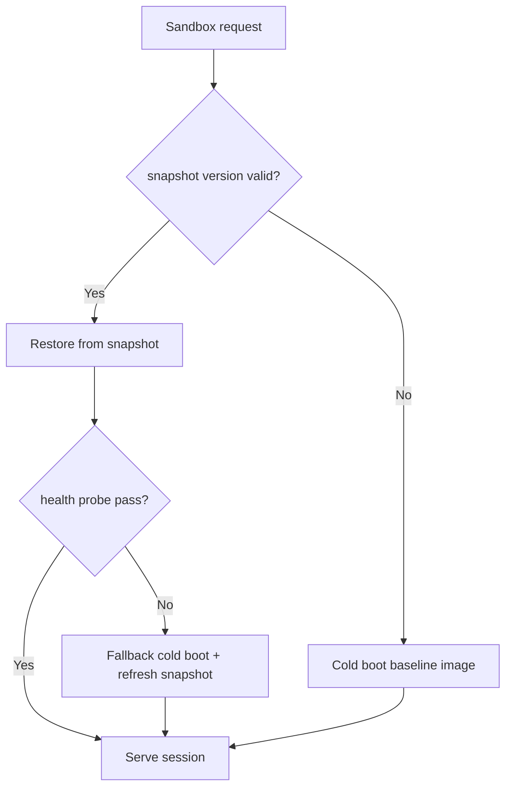
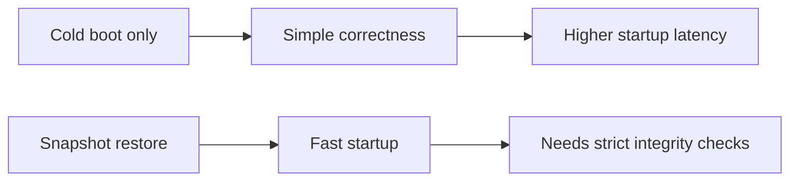
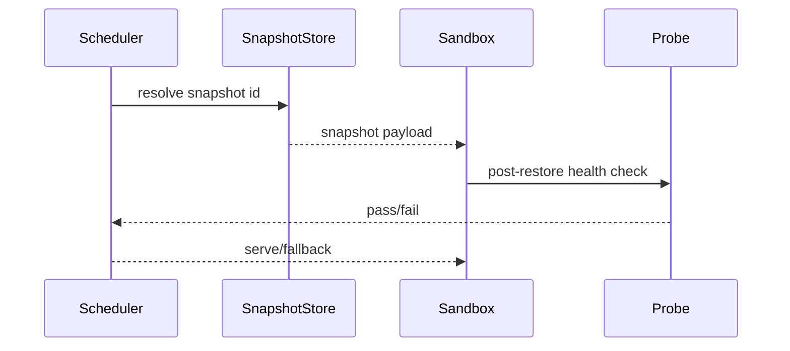

# Agent Kata Firecracker Snapshot Restore Selection FAQ (Azure AI Agent Infra)

## 1) 3-minute conclusions
- **Kata/Firecracker snapshot restore can cut sandbox cold start sharply, but snapshot consistency is the top risk.**
- **Use signed baseline image + snapshot version lock + post-restore health probes.**
- **Targets: `restore_p95 <1.4s`, `snapshot_mismatch=0`, `post_restore_fail <0.3%`.**

## 2) Q1 / Q2 / Q3
- **Why restore fails?** Image-layer and snapshot version drift.
- **Why not rely on snapshots only?** Stale snapshots can carry dirty state.
- **Minimum loop?** Version lock, integrity checks, post-restore probes.

### Q1: When to fallback to cold boot?
When probe fails or version validation fails.

### Q2: When to refresh snapshot baseline?
After image upgrades or security patches.

### Q3: How to evaluate gain?
Compare startup latency reduction and restore failure rate.

## 3) Mermaid diagrams
### 3.1 Decision tree

### 3.2 Path comparison

### 3.3 Sequence

## 4) Decision matrix
| Dimension | Cold boot | Snapshot restore (Recommended) |
|---|---:|---:|
| Startup speed | Low | High |
| Consistency risk | Low | Medium |
| Ops complexity (1-10) | 3 | 8 |
| Fallback capability | Medium | High |
| Resource efficiency | Medium | High |

## 5) Quant model + 7-card insights
- Restore gain: `RestoreGain = ColdBootP95 - SnapshotP95`
- Failure rate: `FailRate = RestoreFail / TotalRestore`
- Example (`synthetic_assumed`):
  - `ColdBootP95=3.2s, SnapshotP95=1.3s`
  - `RestoreGain=1.9s`
  - `RestoreFail=19, TotalRestore=8,200`
  - `FailRate=0.23%`
- Evidence:
  - `workshops/azure-agent-infra/evidence/cycle-1485-benchmark.json`
  - `workshops/azure-agent-infra/evidence/cycle-1485-sources.json`
- Labels: `official/synthetic_assumed/not_measured`.

## 6) Production verification checklist
- [ ] Snapshot version lock and signature checks are enabled
- [ ] Post-restore health probes are replayable
- [ ] Fallback cold-boot path is validated
- [ ] Snapshot refresh workflow is patch-coupled
- [ ] FAQ/7-card source labels are complete
