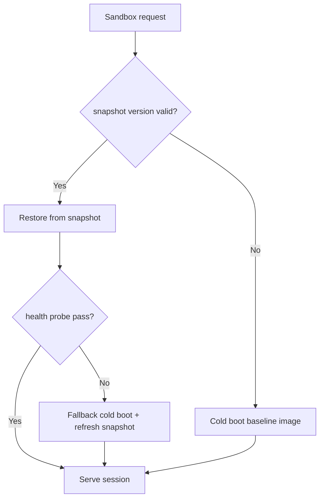
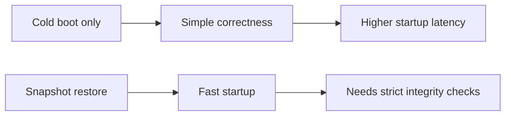
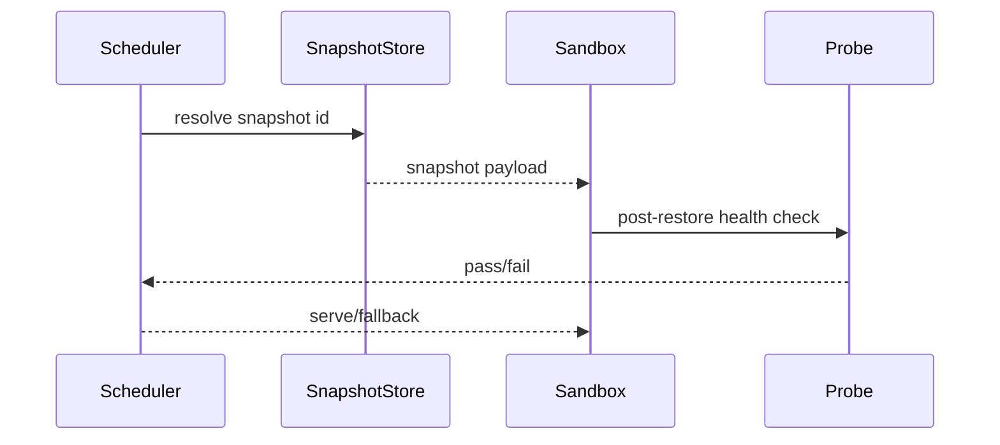

# Agent Kata Firecracker Snapshot Restore 选型 FAQ（Azure AI Agent Infra）

## 1) 3 分钟结论
- **Kata/Firecracker 快照恢复可显著降低沙盒冷启动，但快照一致性是首要风险。**
- **推荐“基线镜像签名 + 快照版本锁 + 恢复后健康探针”三段保障。**
- **目标阈值：`restore_p95 <1.4s`、`snapshot_mismatch=0`、`post_restore_fail <0.3%`。**

## 2) Q1 / Q2 / Q3
- **为何恢复失败？**：镜像层与快照版本偏移。
- **为何不能全依赖快照？**：快照陈旧会带入脏状态。
- **最小闭环？**：版本锁、完整性校验、恢复后探针。

### Q1：何时回退全启动？
探针失败或版本校验不通过。

### Q2：何时刷新快照基线？
镜像版本升级或安全补丁发布后。

### Q3：如何评估收益？
比较恢复时延下降与失败率变化。

## 3) Mermaid 图
### 3.1 决策树

### 3.2 路径对比

### 3.3 时序

## 4) 决策矩阵
| 维度 | 冷启动 | 快照恢复（推荐） |
|---|---:|---:|
| 启动速度 | 低 | 高 |
| 一致性风险 | 低 | 中 |
| 运维复杂度（1-10） | 3 | 8 |
| 回退能力 | 中 | 高 |
| 资源效率 | 中 | 高 |

## 5) 定量算例与 7-Card 洞察
- 恢复收益：`RestoreGain = ColdBootP95 - SnapshotP95`
- 失败率：`FailRate = RestoreFail / TotalRestore`
- 示例（`synthetic_assumed`）：
  - `ColdBootP95=3.2s, SnapshotP95=1.3s`
  - `RestoreGain=1.9s`
  - `RestoreFail=19, TotalRestore=8,200`
  - `FailRate=0.23%`
- 证据：
  - `workshops/azure-agent-infra/evidence/cycle-1485-benchmark.json`
  - `workshops/azure-agent-infra/evidence/cycle-1485-sources.json`
- 标签：`official/synthetic_assumed/not_measured`。

## 6) 生产核验 Checklist
- [ ] 快照版本锁与签名校验启用
- [ ] 恢复后健康探针可回放
- [ ] 失败回退冷启动链路可用
- [ ] 快照刷新流程与补丁联动
- [ ] FAQ/7-Card 来源标签完整
