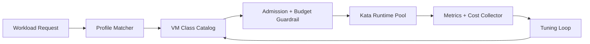

# Kata VM Class Rightsizing Catalog Selection FAQ (Cycle 1890)

## 1) Three-minute decision
- **Core issue:** without a unified Kata VM class catalog, multi-tenant workloads drift toward over-provisioning and capacity fragmentation.
- **Recommendation:** use a tiered VM class catalog with workload profiling and budget guardrails.
- **Goal:** reduce per-task cost while preserving isolation and performance SLOs.

## 2) Q1 / Q2 / Q3
### Q1: Why is a VM class rightsizing catalog necessary?
1) default oversized classes waste resources,
2) heterogeneous workloads cannot be served by one shape,
3) governance becomes inconsistent across teams without a catalog.

### Q2: What are the production essentials?
- **Tiered catalog:** tiny/small/medium/large mapped to CPU, memory, and IO limits,
- **Profile matching:** historical execution signatures select default classes,
- **Upgrade loop:** threshold breaches trigger controlled upsize and replay logs,
- **Budget guardrails:** over-budget class usage raises alerts and approvals.

### Q3: What is the go-live bar?
- lower per-task cost at equivalent throughput,
- no regression in tail latency or failure rate,
- class migration policy remains explainable and reversible.

## 3) Reference architecture

## 4) Decision matrix
| Dimension | Fixed oversized class | VM Class Catalog (Recommended) |
|---|---:|---:|
| Cost efficiency | Low | High |
| Performance stability | Medium | High |
| Governance explainability | Low | High |
| Operations complexity | Low | Medium |
| Multi-tenant scalability | Medium | High |

## 5) Evidence and reproducibility
- Evidence files:
  - `workshops/azure-agent-infra/evidence/cycle-1890-benchmark.json`
  - `workshops/azure-agent-infra/evidence/cycle-1890-latency.csv`
  - `workshops/azure-agent-infra/evidence/cycle-1890-throughput.csv`
  - `workshops/azure-agent-infra/evidence/cycle-1890-cost.csv`
- Labels: `measured / synthetic / anonymized_reported`.
- Validation chain covers structure integrity, CSP, cycle/topic binding, and simulator checks.

## 6) Production checklist
- [ ] VM class catalog is versioned and reversible.
- [ ] Profile matching rules are explainable and periodically retrained.
- [ ] Budget guardrails include alerts and approval paths.
- [ ] Upsize policy has cooldown and retry limits.
- [ ] FAQ/H5/SVG/7-card/evidence remain cycle-consistent.
