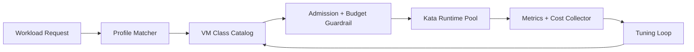

# Kata VM Class Rightsizing Catalog 选型 FAQ（Cycle 1890）

## 1) 3 分钟结论
- **核心问题：** Kata 沙箱规格若缺少统一 vm class catalog，会在多租户场景形成过度配置与容量碎片。
- **推荐方案：** 构建“分层 vm class 目录 + 负载画像匹配 + 成本护栏回路”。
- **目标：** 降低单位任务成本，同时保持隔离与性能 SLO。

## 2) Q1 / Q2 / Q3
### Q1：为什么需要 vm class rightsizing catalog？
1) 默认大规格会放大闲置资源；
2) 任务负载差异大，单一规格难以兼顾；
3) 无目录时难以做跨团队一致治理。

### Q2：生产落地要素有哪些？
- **目录分层：** tiny/small/medium/large 映射 CPU、内存、IO 上限；
- **画像匹配：** 基于历史执行特征推荐默认 class；
- **升级回路：** 超阈值自动升档并记录回放；
- **成本护栏：** 对超预算 class 触发告警与审批。

### Q3：上线判据是什么？
- 同吞吐目标下单任务成本下降；
- 尾延迟与失败率不劣化；
- class 迁移策略可解释、可回滚。

## 3) 架构图

## 4) 选型矩阵
| 维度 | 固定大规格 | VM Class Catalog（推荐） |
|---|---:|---:|
| 成本效率 | 低 | 高 |
| 性能稳定性 | 中 | 高 |
| 治理可解释性 | 低 | 高 |
| 运维复杂度 | 低 | 中 |
| 多租户扩展性 | 中 | 高 |

## 5) 证据与复算口径
- 证据文件：
  - `workshops/azure-agent-infra/evidence/cycle-1890-benchmark.json`
  - `workshops/azure-agent-infra/evidence/cycle-1890-latency.csv`
  - `workshops/azure-agent-infra/evidence/cycle-1890-throughput.csv`
  - `workshops/azure-agent-infra/evidence/cycle-1890-cost.csv`
- 标签：`measured / synthetic / anonymized_reported`。
- 验证链覆盖：结构完整性、CSP、cycle/topic 绑定、模拟器检查。

## 6) 生产检查清单
- [ ] vm class 目录具备版本化与回滚机制。
- [ ] 画像匹配规则可解释并定期复训。
- [ ] 成本护栏策略含告警与审批路径。
- [ ] 超阈值升档策略有冷却与重试上限。
- [ ] FAQ/H5/SVG/7-card/evidence 保持轮次一致。
