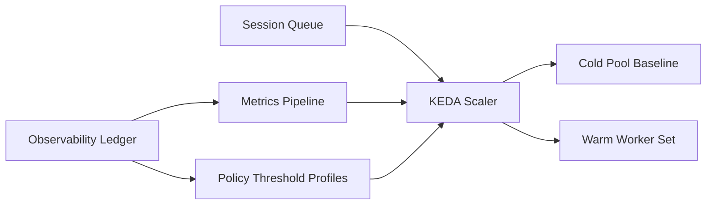

# KEDA Cold-Pool Refill Scaler Selection FAQ (Cycle 1843)

## 1) Three-minute decision
- **Core tradeoff:** aggressive scaling inflates idle cost, while conservative scaling causes cold-start queueing and latency spikes.
- **Recommendation:** KEDA event-driven scaling with prewarmed cold-pool baseline, tiered thresholds, and oscillation damping.
- **Goal:** keep P95 latency stable under burst load while controlling idle instance spend.

## 2) Q1 / Q2 / Q3
### Q1: Why is CPU-only HPA insufficient?
1) CPU is lagging for burst queues and cannot prefill capacity,
2) long cold-start chains degrade user latency before scaling catches up,
3) mixed multi-tenant workload pressure is not represented by CPU alone.

### Q2: What is a production-grade cold-pool refill scaling strategy?
- **Event-driven scaling:** queue depth, session request rate, and timeout ratio feed KEDA,
- **Cold-pool baseline:** maintain minimum prewarmed workers for routine bursts,
- **Tiered thresholds:** separate trigger profiles for light/medium/heavy load,
- **Oscillation control:** cooldown plus minimum runtime to prevent thrash.

### Q3: How do we validate success?
- lower peak-period P95 latency,
- lower cold-start failure and queue-timeout rates,
- predictable per-session cost within SLA budgets.

## 3) Reference architecture

## 4) Decision matrix
| Dimension | CPU-only HPA | KEDA + cold-pool refill (Recommended) |
|---|---:|---:|
| Cold-start control | Low | High |
| Peak-latency stability | Low | High |
| Cost control | Medium | High |
| Implementation complexity | Low | Medium |
| Multi-tenant fit | Low | High |

## 5) Evidence and reproducibility
- Evidence files:
  - `workshops/azure-agent-infra/evidence/cycle-1843-benchmark.json`
  - `workshops/azure-agent-infra/evidence/cycle-1843-latency.csv`
  - `workshops/azure-agent-infra/evidence/cycle-1843-throughput.csv`
  - `workshops/azure-agent-infra/evidence/cycle-1843-policy.csv`
- Labels: `measured / synthetic / anonymized_reported`.
- validation7 enforces bilingual six-part structure, CSP self-contained 7-card output, strict cycle-evidence alignment, and replayability.

## 6) Production checklist
- [ ] KEDA event signals and threshold profiles are configured.
- [ ] Time-of-day cold-pool baseline is active.
- [ ] Cooldown and minimum runtime settings are validated.
- [ ] Peak replay meets latency and cost targets.
- [ ] FAQ/H5/SVG/7-card align with cycle evidence.
