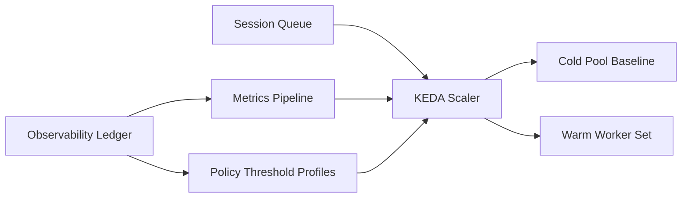

# KEDA 冷池补位伸缩器选型 FAQ（Cycle 1843）

## 1) 3 分钟结论
- **核心矛盾：** 扩缩容太激进会造成空转成本，太保守会导致冷启动排队与延迟飙升。
- **推荐：** KEDA 事件驱动伸缩 + 预热冷池基线 + 分层阈值与抖动抑制。
- **目标：** 在突发负载下稳定 P95 延迟，同时控制空闲实例成本。

## 2) Q1 / Q2 / Q3
### Q1：为什么只靠 CPU/HPA 扩容不够？
1) CPU 指标对突发队列滞后，无法提前补位；
2) 冷启动链路较长时，用户排队先恶化后扩容；
3) 多模型多租户请求混合下，CPU 不能反映真实会话压力。

### Q2：生产级冷池补位伸缩策略是什么？
- **事件驱动：** 以队列深度、会话请求率、超时率驱动 KEDA；
- **冷池基线：** 保持最小预热实例，覆盖常见突发；
- **分层阈值：** 轻载/中载/高载使用不同触发阈值；
- **抖动抑制：** 缩容冷却窗口 + 最小运行时长，避免频繁抖动。

### Q3：如何衡量是否选型成功？
- 高峰期 P95 延迟下降；
- 冷启动失败率与排队超时率下降；
- 单会话成本在 SLA 内可预测。

## 3) 架构图

## 4) 选型矩阵
| 维度 | 仅 CPU/HPA | KEDA + 冷池补位（推荐） |
|---|---:|---:|
| 冷启动控制 | 低 | 高 |
| 峰值延迟稳定性 | 低 | 高 |
| 成本可控性 | 中 | 高 |
| 实施复杂度 | 低 | 中 |
| 多租户适配 | 低 | 高 |

## 5) 证据与复算口径
- 证据文件：
  - `workshops/azure-agent-infra/evidence/cycle-1843-benchmark.json`
  - `workshops/azure-agent-infra/evidence/cycle-1843-latency.csv`
  - `workshops/azure-agent-infra/evidence/cycle-1843-throughput.csv`
  - `workshops/azure-agent-infra/evidence/cycle-1843-policy.csv`
- 标签：`measured / synthetic / anonymized_reported`。
- validation7：双语六段结构、7-card CSP 自包含、轮次与 evidence 一致、可回放链路通过。

## 6) 生产检查清单
- [ ] KEDA 事件指标与阈值配置完成。
- [ ] 冷池基线容量按时段策略生效。
- [ ] 缩容冷却与最小运行时长已验证。
- [ ] 高峰回放中延迟与成本达标。
- [ ] FAQ/H5/SVG/7-card 与 evidence 轮次一致。
