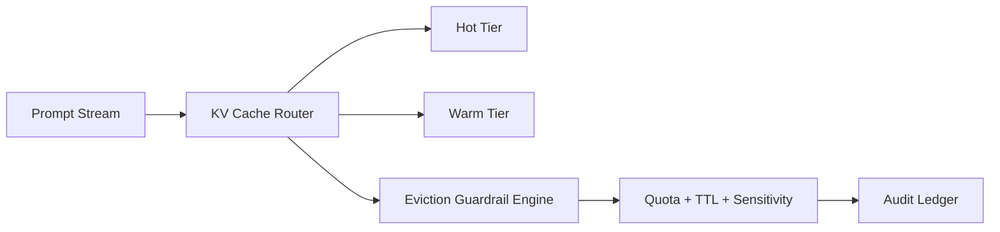

# Agent KV Cache Eviction Guardrails Selection FAQ (Cycle 1790)

## 1) Three-minute decision
- **The key is not whether KV cache is enabled, but how eviction stays safe under multi-tenant long-context traffic.**
- **Recommendation:** TTL + heat tiers + tenant quotas + forced short retention for sensitive contexts.
- **Goal:** reduce token cost and tail latency without cross-tenant contamination risk.

## 2) Core questions (Q1/Q2/Q3)
### Q1: Why does plain LRU fail?
1) hot sessions crowd out long-tail business,
2) sensitive context cannot be governed by policy,
3) cross-tenant contention destabilizes hit rate.

### Q2: What production strategy works?
- layer 1: hard tenant quota caps,
- layer 2: session TTL classes (short/medium/long),
- layer 3: combined heat + freshness eviction score,
- exception: sensitive sessions get earlier eviction.

### Q3: How to prove effectiveness?
- P95 latency drops or remains stable,
- hit-rate variance across tenants declines,
- per-session cost decreases with bounded drift.

## 3) Reference architecture

## 4) Decision matrix
| Dimension | Plain LRU | Guardrail eviction (Recommended) |
|---|---:|---:|
| Multi-tenant fairness | Low | High |
| Sensitive-context governance | Low | High |
| Cost control | Medium | High |
| Hit-rate stability | Medium | High |
| Implementation complexity | Low | Medium |

## 5) Evidence and reproducibility
- Evidence files:
  - `workshops/azure-agent-infra/evidence/cycle-1790-benchmark.json`
  - `workshops/azure-agent-infra/evidence/cycle-1790-latency.csv`
  - `workshops/azure-agent-infra/evidence/cycle-1790-throughput.csv`
  - `workshops/azure-agent-infra/evidence/cycle-1790-policy.csv`
- Data labels: `measured / synthetic / anonymized_reported`.
- validation7 requires structure fidelity, evidence consistency, CSP self-contained cards, and replayability.

## 6) Production checklist
- [ ] Hard tenant quota caps are enabled.
- [ ] Session TTL classes are rollout-ready.
- [ ] Sensitive-session short-retention policy is active.
- [ ] Eviction events are auditable.
- [ ] FAQ/H5/SVG/7-card are cycle-consistent with evidence.
