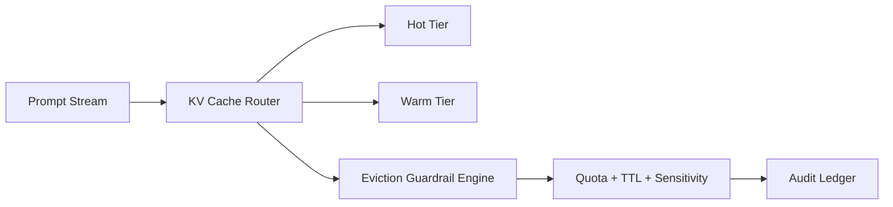

# Agent KV Cache 驱逐护栏选型 FAQ（Cycle 1790）

## 1) 3 分钟结论
- **问题核心不是“是否启用 KV Cache”，而是“在多租户与长对话下如何安全驱逐”。**
- **推荐：** TTL + 热度分层 + 租户配额 + 敏感上下文强制短保留。
- **目标：** 降低 token 成本与尾延迟，同时不引入跨租户污染风险。

## 2) 关键问题（Q1/Q2/Q3）
### Q1：为什么单一 LRU 会失效？
1) 高并发下热门会话挤压长尾业务；
2) 敏感上下文残留风险无法按策略隔离；
3) 跨租户资源争用导致命中率波动。

### Q2：生产可落地的驱逐策略？
- 一级：租户配额硬上限；
- 二级：会话 TTL 分档（短/中/长）；
- 三级：热度与新鲜度综合评分驱逐；
- 例外：敏感标签会话优先短保留并提前淘汰。

### Q3：如何证明策略有效？
- P95 延迟下降或持平；
- 命中率稳定且跨租户方差下降；
- 单会话成本下降并受控。

## 3) 架构图

## 4) 选型矩阵
| 维度 | 纯 LRU | 护栏驱逐（推荐） |
|---|---:|---:|
| 多租户公平性 | 低 | 高 |
| 敏感上下文治理 | 低 | 高 |
| 成本可控性 | 中 | 高 |
| 命中率稳定性 | 中 | 高 |
| 落地复杂度 | 低 | 中 |

## 5) 证据与复算口径
- 证据文件：
  - `workshops/azure-agent-infra/evidence/cycle-1790-benchmark.json`
  - `workshops/azure-agent-infra/evidence/cycle-1790-latency.csv`
  - `workshops/azure-agent-infra/evidence/cycle-1790-throughput.csv`
  - `workshops/azure-agent-infra/evidence/cycle-1790-policy.csv`
- 数据标签：`measured / synthetic / anonymized_reported`。
- validation7：结构、证据、CSP 与可回放链路全通过。

## 6) 生产检查清单
- [ ] 租户配额硬限制已启用。
- [ ] 会话 TTL 分档有发布策略。
- [ ] 敏感标签会话短保留策略生效。
- [ ] 驱逐事件可审计并可追责。
- [ ] FAQ/H5/SVG/7-card 与证据轮次一致。
