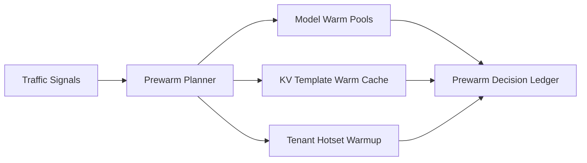

# Agent KV Cold-Start Prewarm Selection FAQ (Cycle 1802)

## 1) Three-minute decision
- **KV cold-start jitter is often caused not by slow models, but by misaligned prewarm coverage versus real traffic shape.**
- **Recommendation:** tiered prewarm (model, prompt templates, tenant hotsets) + budget guardrails + automatic refill on decay.
- **Goal:** reduce first-token and tail latency without overspending on unnecessary warmups.

## 2) Core questions (Q1/Q2/Q3)
### Q1: Why is full static prewarm unsustainable?
1) long-tail paths waste budget,
2) hotspot patterns shift quickly,
3) prewarm jobs contend with live traffic resources.

### Q2: What is a practical prewarm policy?
- layer 1: always-warm critical models and core prompt templates,
- layer 2: rolling warmup for tenant hotsets,
- layer 3: auto-refill when warm-hit decays,
- guardrail: downshift when prewarm budget exceeds threshold.

### Q3: How to validate effectiveness?
- first-token time and P95 decrease materially,
- prewarm hit-rate stays in target band,
- per-session cost avoids abnormal inflation.

## 3) Reference architecture

## 4) Decision matrix
| Dimension | Static full prewarm | Tiered dynamic prewarm (Recommended) |
|---|---:|---:|
| Cold-start improvement | Medium | High |
| Cost controllability | Low | High |
| Hotspot adaptability | Low | High |
| Operational complexity | Low | Medium |
| Observability | Medium | High |

## 5) Evidence and reproducibility
- Evidence files:
  - `workshops/azure-agent-infra/evidence/cycle-1802-benchmark.json`
  - `workshops/azure-agent-infra/evidence/cycle-1802-latency.csv`
  - `workshops/azure-agent-infra/evidence/cycle-1802-throughput.csv`
  - `workshops/azure-agent-infra/evidence/cycle-1802-policy.csv`
- Labels: `measured / synthetic / anonymized_reported`.
- validation7 requires bilingual structure fidelity, CSP self-contained cards, cycle-consistent evidence, and replayability checks.

## 6) Production checklist
- [ ] Prewarm tiers and budget thresholds are configured.
- [ ] Hotset detection windows update dynamically.
- [ ] Refill and downshift controls auto-trigger correctly.
- [ ] Hit-rate and cost metrics are alerted.
- [ ] FAQ/H5/SVG/7-card align with cycle evidence.
