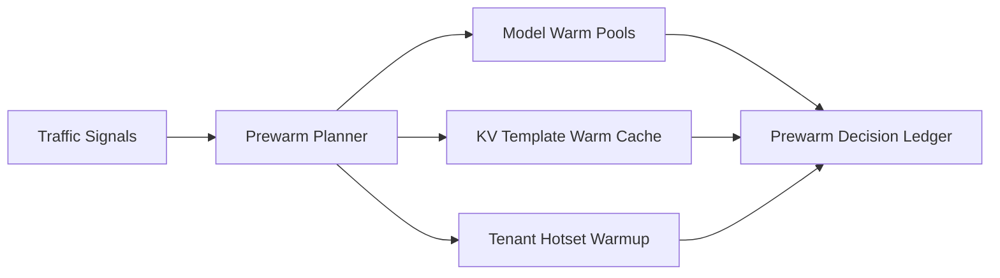

# Agent KV 冷启动预热选型 FAQ（Cycle 1802）

## 1) 3 分钟结论
- **KV 冷启动抖动通常不是模型本身慢，而是预热覆盖策略与实际流量结构错位。**
- **推荐：** 分层预热（模型、提示模板、租户热点）+ 预算阈值守卫 + 失效自动回补。
- **目标：** 降低首包与尾延迟，避免过度预热造成成本浪费。

## 2) 关键问题（Q1/Q2/Q3）
### Q1：为什么“全量预热”不可持续？
1) 冷门路径大量浪费预算；
2) 热点变化快，静态名单很快失效；
3) 预热任务争抢线上资源。

### Q2：可落地的预热策略是什么？
- 一级：核心模型与关键提示模板常驻预热；
- 二级：按租户热点动态滚动预热；
- 三级：预热命中衰减时触发自动回补；
- 护栏：预热预算超阈值自动降档。

### Q3：如何验证策略有效？
- 首包时间和 P95 明显下降；
- 预热命中率稳定在目标区间；
- 单会话成本没有异常放大。

## 3) 架构图

## 4) 选型矩阵
| 维度 | 静态全量预热 | 分层动态预热（推荐） |
|---|---:|---:|
| 冷启动改善 | 中 | 高 |
| 成本可控性 | 低 | 高 |
| 热点适应性 | 低 | 高 |
| 运维复杂度 | 低 | 中 |
| 可观测性 | 中 | 高 |

## 5) 证据与复算口径
- 证据文件：
  - `workshops/azure-agent-infra/evidence/cycle-1802-benchmark.json`
  - `workshops/azure-agent-infra/evidence/cycle-1802-latency.csv`
  - `workshops/azure-agent-infra/evidence/cycle-1802-throughput.csv`
  - `workshops/azure-agent-infra/evidence/cycle-1802-policy.csv`
- 标签：`measured / synthetic / anonymized_reported`。
- validation7：双语结构、CSP 自包含、证据轮次一致、可回放链路校验通过。

## 6) 生产检查清单
- [ ] 预热层级与预算阈值已配置。
- [ ] 热点识别窗口支持动态更新。
- [ ] 预热回补与降档策略可自动触发。
- [ ] 预热命中与成本指标有告警。
- [ ] FAQ/H5/SVG/7-card 与 evidence 轮次一致。
