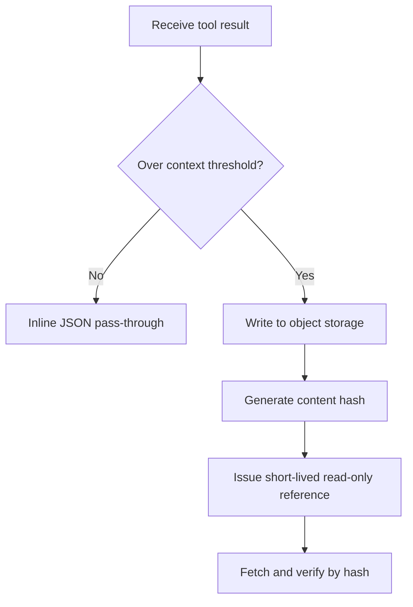
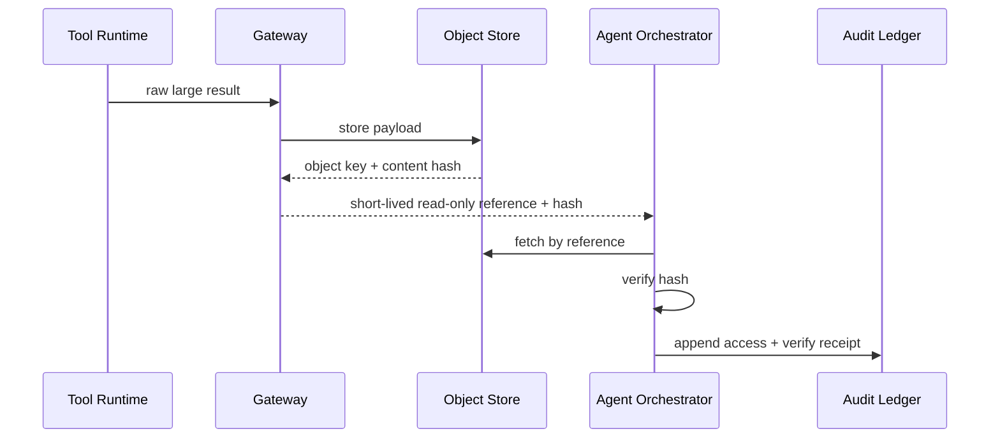

# Agent Large Tool Result Offload Strategy FAQ (Inline JSON vs Object-Store Hash Reference)

> Scope lock: this FAQ focuses on large tool-result delivery strategy only (gateway budgets, payload integrity, expiry/re-fetch, tenant boundaries), not model-quality comparisons.

## 📌 Core takeaways (3 bullets)

1. **Inline small results, offload large results**: plain language, carry small parcels by hand and send big parcels through warehousing receipts.  
2. **Offload must pair content hash with short-lived read-only reference**: first principle is to separate data integrity control from access control.  
3. **Production baseline should be tiered**: automatic inline/offload switching by size+risk threshold with full expiry/re-fetch audit trail.

## 🎯 Q1: Why not always inline large tool results into context?

- **Plain language**: oversized inline payloads crowd out the context window and hide the actually relevant facts.  
- **First principle**: context tokens are scarce budget; large inline payloads increase latency, cost, and reasoning noise.

## 🎯 Q2: When should inline be kept, and when must offload be used?

- **Inline first**: short structured outputs and deterministic small fields.  
- **Offload first**: screenshots, long logs, table chunks, document fragments, binary-derived artifacts.  
- **Rule**: offload whenever context threshold is exceeded, compliance risk is raised, or replay/audit is required.

## 🎯 Q3: How does object-store offload preserve integrity and tenant boundaries?

- **Plain language**: store payload in a vault, share a temporary pickup ticket, and verify with a checksum.  
- **First principle**: content hash proves what was fetched; short-lived read-only reference limits who can fetch and for how long.  
- **Path**: tool result -> gateway size/risk decision -> object storage write -> hash + TTL reference issuance -> fetch with hash verification -> expiry-aware re-fetch.

## 🧭 Mermaid (TD decision tree + LR path + sequence)

## 📊 Architect decision matrix

| Dimension | Inline JSON | Object-store hash reference | Tiered hybrid (recommended) |
|---|---|---|---|
| Context budget pressure | High (for large payloads) | Low | Low |
| Payload integrity proof | Medium | High | High |
| Permission/expiry control | Low | High | High |
| Implementation complexity | Low | Medium | Medium |
| Best-fit workload | Small fast-path results | Large/compliance-heavy outputs | Mixed production workloads |

## 🧪 Quant example + 7-card 4:5 insights

| Metric | Inline baseline | Tiered offload baseline |
|---|---:|---:|
| Cold start/restore P50 (ms) | 99 | 103 |
| Cold start/restore P95 (ms) | 158 | 168 |
| Throughput P50 (rps) | 1680 | 1570 |
| Large-output integrity verification pass rate | 94.0% | 96.3% |
| Cost per session (USD/20min) | 0.00483 | 0.00509 |

- 7-card output: `benchmark-cards.html` / `benchmark-cards.en.html`  
- Evidence pack: `evidence/cycle-413-benchmark.json`, `evidence/cycle-413-sources.json`  
- Labeling: `measured / synthetic / anonymized_reported` (production gaps marked as `not_measured`)

## 🛠️ Production verification checklist

- [ ] Define inline/offload thresholds (payload bytes, token budget, risk tags)
- [ ] Enforce content-hash verification and fallback behavior on mismatch
- [ ] Bind short-lived read-only references to tenant identity and least privilege
- [ ] Make expiry/re-fetch policy replayable and auditable
- [ ] Ensure every 7-card coordinate is evidence-backed; mark missing points as `not_measured`
