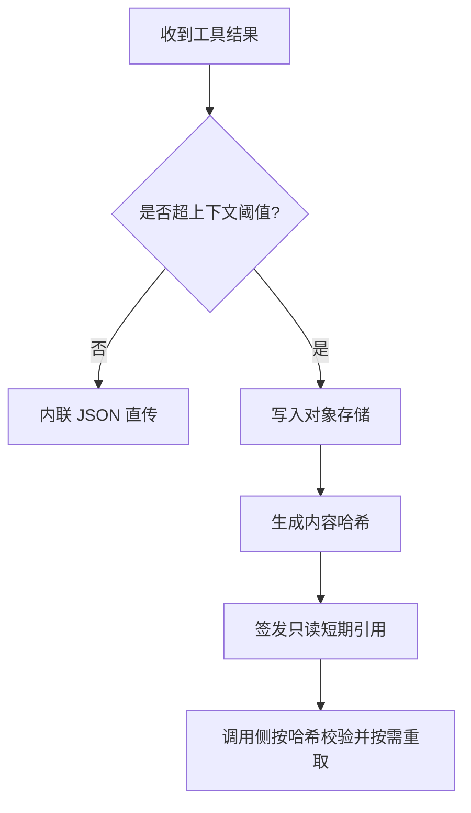
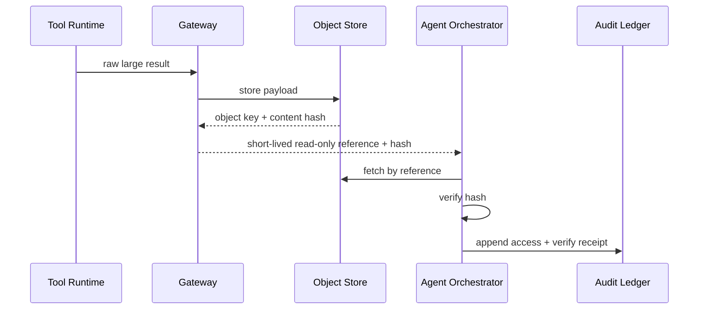

# Agent 大型工具结果外置策略选型 FAQ（直接内联 JSON vs 对象存储哈希引用）

> 专题边界：仅讨论 Agent 工具结果过大时的传递与治理策略（网关、上下文预算、完整性、过期与重取、租户边界），不讨论模型能力优劣。

## 📌 核心结论速览（3 条）

1. **小结果可内联，大结果必须外置**：大白话就是“小包裹可手提，大包裹必须走仓储单据”。  
2. **外置必须“内容哈希 + 只读短期引用”成对落地**：第一性原理是把“数据内容”和“访问权限”分离控制，防篡改也防越权。  
3. **生产默认分层策略**：按结果大小与风险阈值自动切换 inline/offload，并把 expiry/re-fetch 全程审计。

## 🎯 Q1：为什么不能把大型工具结果一直内联到上下文？

- **大白话**：内联太大就会“挤爆上下文”，后续推理反而看不见真正关键信息。  
- **第一性原理**：LLM 上下文是稀缺预算，超大 payload 进入 prompt 会同时拉高延迟、成本和错误率。

## 🎯 Q2：什么时候保留内联？什么时候必须外置？

- **内联优先**：结构化小结果、短文本、确定性字段（例如几十到几百 token）。  
- **外置优先**：截图、日志块、表格片段、长文档、二进制派生物等大体积结果。  
- **判定规则**：超过上下文阈值、触发租户合规标记、需复核回放任一条件即外置。

## 🎯 Q3：对象存储外置怎么保证完整性和权限边界？

- **大白话**：结果先存“保险箱”，只给“带时效的取件码”，并附“校验码”。  
- **第一性原理**：内容哈希保证“拿到的是原文”，短期只读引用保证“谁能拿、拿多久”可控。  
- **落地链路**：工具结果产出 -> 网关大小/风险判定 -> 对象存储写入 -> 生成 hash + TTL 引用 -> 调用侧按 hash 校验 -> 过期后按策略重取。

## 🧭 Mermaid（决策树 TD + 路径 LR + 时序）

## 📊 架构师决策矩阵

| 维度 | 直接内联 JSON | 对象存储哈希引用 | 分层组合（推荐） |
|---|---|---|---|
| 上下文预算压力 | 高（大结果时） | 低 | 低 |
| 载荷完整性证明 | 中 | 高 | 高 |
| 权限与时效控制 | 低 | 高 | 高 |
| 实现复杂度 | 低 | 中 | 中 |
| 适配场景 | 小结果快路径 | 大结果与合规场景 | 混合生产场景 |

## 🧪 定量算例 + 7-Card 4:5 洞察

| 指标 | 内联基线 | 分层外置基线 |
|---|---:|---:|
| 冷启动/恢复 P50 (ms) | 99 | 103 |
| 冷启动/恢复 P95 (ms) | 158 | 168 |
| 并发吞吐 P50 (rps) | 1680 | 1570 |
| 大结果完整性校验通过率 | 94.0% | 96.3% |
| 单会话成本 (USD/20min) | 0.00483 | 0.00509 |

- 7-card 输出：`benchmark-cards.html` / `benchmark-cards.en.html`  
- 证据包：`evidence/cycle-413-benchmark.json`、`evidence/cycle-413-sources.json`  
- 标签：`measured / synthetic / anonymized_reported`（生产未跑指标标记为 `not_measured`）

## 🛠️ 生产核验 Checklist

- [ ] 定义 inline/offload 阈值（payload 字节、token 预算、风险标签）
- [ ] 强制内容哈希校验与失败回退策略
- [ ] 只读短期引用绑定租户身份与最小权限
- [ ] 过期与重取策略可审计、可回放、可追责
- [ ] 7-card 坐标全部可追溯到封存证据，缺失项显式 `not_measured`
