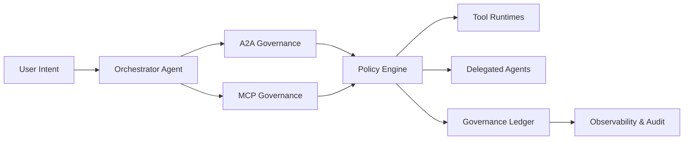

# Agent MCP/A2A Governance Plane Selection FAQ (Cycle 1823)

## 1) Three-minute decision
- **Core tension:** as tool calls and inter-agent delegations grow, permission drift, routing instability, and audit gaps become systemic.
- **Recommendation:** unified governance plane across MCP tools and A2A delegations.
- **Goal:** enforce authorization, observability, and accountability in multi-agent production orchestration.

## 2) Q1 / Q2 / Q3
### Q1: Why is API-layer auth alone insufficient?
1) auth scoped only to endpoints misses session/tool context,
2) A2A forwarding amplifies implicit privilege inheritance,
3) without a unified event model, cross-agent forensics are slow.

### Q2: What governance plane design is production-ready?
- **Identity layer:** separate principal identities for agents, tools, and sessions,
- **Policy layer:** unified allow/deny/shape for MCP calls and A2A delegations,
- **Observability layer:** shared traces/spans with policy-hit signals,
- **Audit layer:** durable decision evidence (who/when/why/what).

### Q3: How do we validate effectiveness?
- higher unauthorized-call interception rate,
- bounded policy false-positive rate,
- materially shorter incident traceback time.

## 3) Reference architecture

## 4) Decision matrix
| Dimension | Fragmented governance | Unified governance plane (Recommended) |
|---|---:|---:|
| Permission boundary clarity | Low | High |
| Cross-agent observability | Low | High |
| Audit traceback efficiency | Medium | High |
| Implementation complexity | Low | Medium |
| Long-term ops cost | Medium-high | Medium |

## 5) Evidence and reproducibility
- Evidence files:
  - `workshops/azure-agent-infra/evidence/cycle-1823-benchmark.json`
  - `workshops/azure-agent-infra/evidence/cycle-1823-latency.csv`
  - `workshops/azure-agent-infra/evidence/cycle-1823-throughput.csv`
  - `workshops/azure-agent-infra/evidence/cycle-1823-policy.csv`
- Labels: `measured / synthetic / anonymized_reported`.
- validation7 enforces bilingual six-part structure, CSP self-contained 7-card output, strict cycle-evidence alignment, and replayability.

## 6) Production checklist
- [ ] Agent/tool/session identity and least-privilege model are finalized.
- [ ] MCP/A2A policy rules support staged rollout and rollback.
- [ ] Trace/audit events carry end-to-end correlation IDs.
- [ ] High-risk policy-hit alerting and response drills are complete.
- [ ] FAQ/H5/SVG/7-card align with cycle evidence.
