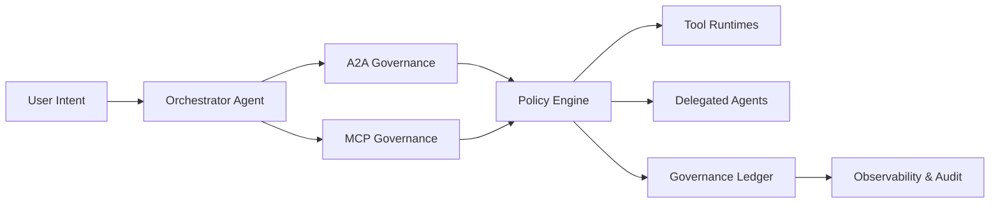

# Agent MCP/A2A 治理平面选型 FAQ（Cycle 1823）

## 1) 3 分钟结论
- **核心矛盾：** 工具调用与 Agent 间协作越多，越容易出现权限漂移、路由失控和审计断层。
- **推荐：** MCP 工具治理 + A2A 协作治理 + 统一策略与审计平面。
- **目标：** 在多 Agent 生产编排中实现“可授权、可观测、可追责”的治理闭环。

## 2) Q1 / Q2 / Q3
### Q1：为什么只做接口层鉴权不够？
1) 授权粒度只到接口，难覆盖会话上下文与工具链路；
2) A2A 转发会放大隐式权限继承；
3) 无统一事件模型时，跨 Agent 追责困难。

### Q2：可落地的治理平面应该怎么设计？
- **身份层**：为 Agent、工具、会话分配独立身份与最小权限；
- **策略层**：对 MCP 工具调用和 A2A 委托统一做 allow/deny/shape；
- **可观测层**：统一 trace/span 与策略命中事件，支持跨域关联；
- **审计层**：保留决策证据（谁、何时、为何、调用了什么）。

### Q3：如何验证治理平面有效？
- 未授权调用拦截率上升；
- 策略误杀率受控；
- 事故回溯时间显著缩短。

## 3) 架构图

## 4) 选型矩阵
| 维度 | 分散治理 | 统一治理平面（推荐） |
|---|---:|---:|
| 权限边界清晰度 | 低 | 高 |
| 跨 Agent 可观测性 | 低 | 高 |
| 审计追溯效率 | 中 | 高 |
| 实施复杂度 | 低 | 中 |
| 长期运维成本 | 中高 | 中 |

## 5) 证据与复算口径
- 证据文件：
  - `workshops/azure-agent-infra/evidence/cycle-1823-benchmark.json`
  - `workshops/azure-agent-infra/evidence/cycle-1823-latency.csv`
  - `workshops/azure-agent-infra/evidence/cycle-1823-throughput.csv`
  - `workshops/azure-agent-infra/evidence/cycle-1823-policy.csv`
- 标签：`measured / synthetic / anonymized_reported`。
- validation7：双语六段结构、7-card CSP 自包含、轮次/evidence 一致、可回放链路通过。

## 6) 生产检查清单
- [ ] Agent/Tool/Session 身份与权限模型已固化。
- [ ] MCP/A2A 策略规则支持分层发布与回滚。
- [ ] Trace/审计事件具备端到端关联 ID。
- [ ] 高风险策略命中告警与处置流程已演练。
- [ ] FAQ/H5/SVG/7-card 与 evidence 轮次一致。
