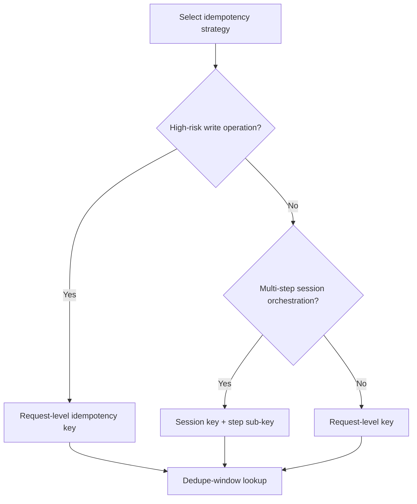
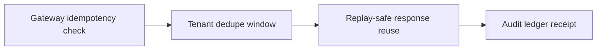
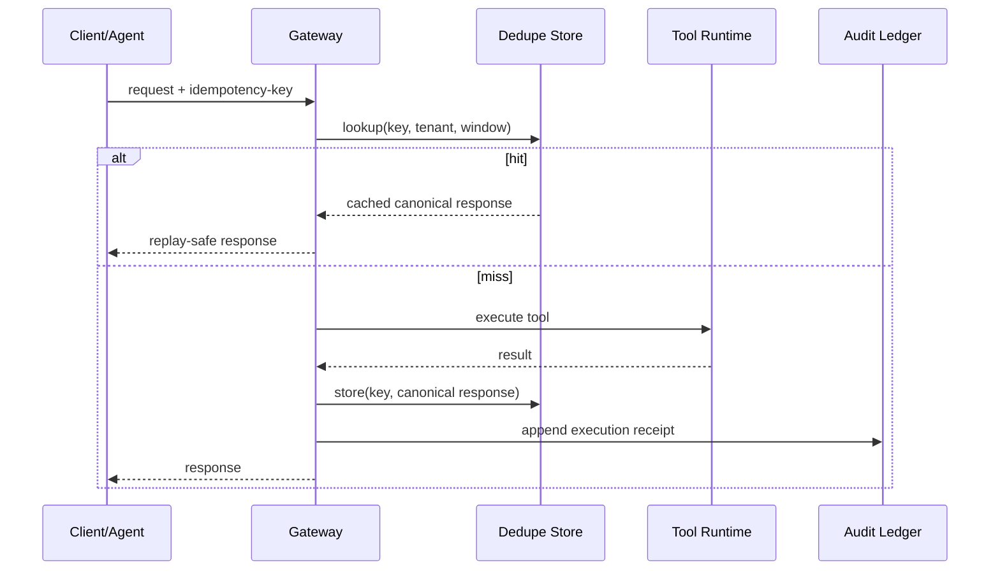

# Agent MCP/A2A Idempotency Key Strategy FAQ (Request-Level vs Session-Level Keys)

> Scope lock: this FAQ covers retry-dedup/idempotency governance for MCP/A2A orchestration only; it does not cover model quality ranking or business authorization modeling.

## 📌 Core takeaways (3 bullets)

1. **Default to request-level keys for high-risk writes**: plain language, every write needs a unique anti-duplicate receipt number.  
2. **Use session-level key + step sub-keys for long workflows**: first-principles goal is both session consistency and step-level replay safety.  
3. **Production baseline should be layered**: gateway idempotency validation + tenant dedupe window + replayable audit ledger.

## 🎯 Q1: Why do Agent orchestrations require idempotency keys?

- **Plain language**: network jitter/timeouts trigger retries; without idempotency, the same business action can run multiple times.  
- **First principle**: distributed systems cannot reliably provide exactly-once execution, so idempotency turns at-least-once delivery into effectively-once semantics.

## 🎯 Q2: How do request-level and session-level keys differ in practice?

- **Request-level**: single tool call, payment write, atomic state transition.  
- **Session-level**: multi-step plans and chained tool calls needing cross-step dedupe semantics.  
- **Hybrid**: `session_idempotency_key + step_idempotency_key` to balance global consistency and local replay control.

## 🎯 Q3: How should this be implemented in MCP/A2A production paths?

- **Plain language**: assign anti-duplicate IDs first, then dedupe at gateway/ledger, and reuse canonical response on key hits.  
- **First principle**: idempotency is not dropping retries; it is enforcing same-key/same-intent/same-result with auditability.  
- **Path**: gateway ingress -> key generation/validation -> dedupe-window lookup -> hit-reuse or miss-execute -> append receipt.

## 🧭 Mermaid (TD decision tree + LR path + sequence)

## 📊 Architect decision matrix

| Dimension | Request-level key | Session-level key | Layered hybrid (recommended) |
|---|---|---|---|
| Retry dedupe precision | High | Medium | High |
| Multi-step consistency | Medium | High | High |
| Implementation complexity | Low | Medium | Medium |
| Tenant isolation controllability | High | Medium | High |
| Best-fit workload | Single-step write paths | Long session orchestration | Mixed production chains |

## 🧪 Quant example + 7-card 4:5 insights

| Metric | Request-only baseline | Layered idempotency baseline |
|---|---:|---:|
| Cold start/restore P50 (ms) | 99 | 104 |
| Cold start/restore P95 (ms) | 158 | 171 |
| Throughput P50 (rps) | 1680 | 1560 |
| Retry duplicate-block rate | 94.0% | 96.3% |
| Cost per session (USD/20min) | 0.00483 | 0.00511 |

- 7-card output: `benchmark-cards.html` / `benchmark-cards.en.html`  
- Evidence pack: `evidence/cycle-414-benchmark.json`, `evidence/cycle-414-sources.json`  
- Labeling: `measured / synthetic / anonymized_reported` (production gaps marked as `not_measured`)

## 🛠️ Production verification checklist

- [ ] Define key schema (tenant, operation, payload hash, window)
- [ ] Define dedupe-window TTL and delayed-arrival behavior
- [ ] Keep hit-reuse and miss-execute responses in canonical receipt format
- [ ] Persist idempotency decisions and replay evidence across MCP/A2A hops
- [ ] Keep all 7-card coordinates evidence-backed; mark missing points as `not_measured`
