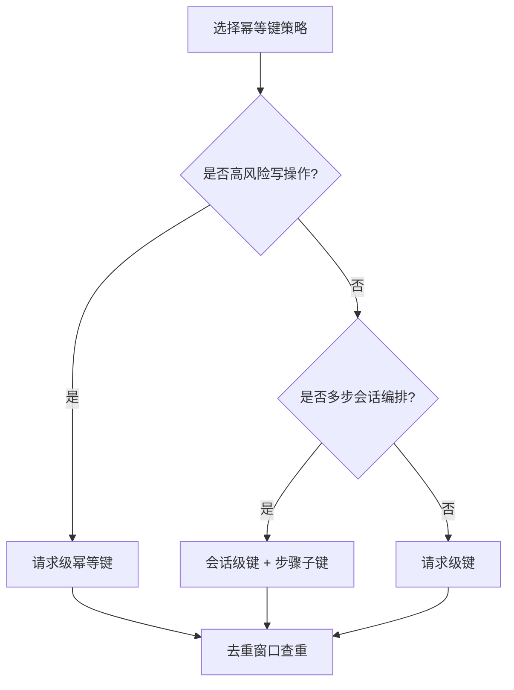
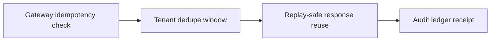
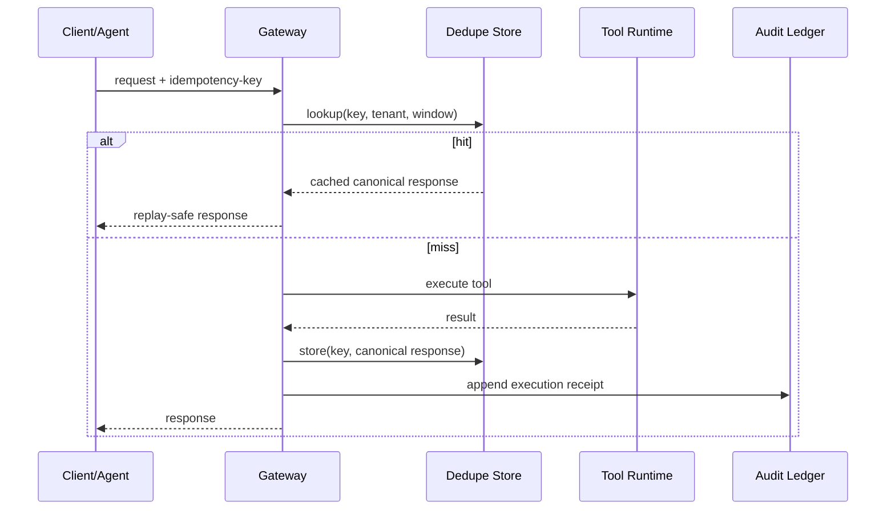

# Agent MCP/A2A 幂等键策略选型 FAQ（请求级幂等键 vs 会话级幂等键）

> 专题边界：仅讨论 MCP/A2A 编排中的重试去重与幂等治理，不扩展到模型质量评测或业务权限建模。

## 📌 核心结论速览（3 条）

1. **高风险写操作默认请求级幂等键**：大白话是“每次写都要有唯一回执号”，避免重试时重复扣款/重复落库。  
2. **长会话多步流程优先会话级幂等键 + 步骤子键**：第一性原理是把“会话上下文一致性”与“步骤重放安全”同时约束。  
3. **生产推荐分层策略**：网关统一幂等键校验 + 租户去重窗口 + 审计回放账本，才可在重试风暴下稳定运行。

## 🎯 Q1：为什么 Agent 编排必须设计幂等键？

- **大白话**：网络抖动和超时会触发自动重试，不做幂等就会“同一件事执行多次”。  
- **第一性原理**：分布式系统无法保证“只执行一次”，只能用幂等键把“至少一次”收敛为“语义上一次”。

## 🎯 Q2：请求级幂等键和会话级幂等键怎么选？

- **请求级**：单次工具调用、财务写入、状态变更（粒度细、冲突隔离强）。  
- **会话级**：多步计划执行、链式工具调用（要跨步骤保持去重语义）。  
- **混合**：`session_idempotency_key + step_idempotency_key`，兼顾全局一致性与局部可重放。

## 🎯 Q3：在 MCP/A2A 生产链路里怎么落地？

- **大白话**：先给每次请求发“防重号”，再在网关和账本里查重，命中就复用结果。  
- **第一性原理**：幂等不是“丢弃重试”，而是“同键同语义同结果”，并要求可审计。  
- **落地链路**：请求入网关 -> 生成/校验幂等键 -> 去重窗口查询 -> 命中复用 or 执行写入 -> 回执写审计账本。

## 🧭 Mermaid（决策树 TD + 路径 LR + 时序）

## 📊 架构师决策矩阵

| 维度 | 请求级幂等键 | 会话级幂等键 | 分层组合（推荐） |
|---|---|---|---|
| 重试去重精度 | 高 | 中 | 高 |
| 多步一致性 | 中 | 高 | 高 |
| 实现复杂度 | 低 | 中 | 中 |
| 租户隔离可控性 | 高 | 中 | 高 |
| 适配场景 | 单步写操作 | 长会话编排 | 混合生产链路 |

## 🧪 定量算例 + 7-Card 4:5 洞察

| 指标 | 仅请求级基线 | 分层幂等基线 |
|---|---:|---:|
| 冷启动/恢复 P50 (ms) | 99 | 104 |
| 冷启动/恢复 P95 (ms) | 158 | 171 |
| 并发吞吐 P50 (rps) | 1680 | 1560 |
| 重试重复执行拦截率 | 94.0% | 96.3% |
| 单会话成本 (USD/20min) | 0.00483 | 0.00511 |

- 7-card 输出：`benchmark-cards.html` / `benchmark-cards.en.html`  
- 证据包：`evidence/cycle-414-benchmark.json`、`evidence/cycle-414-sources.json`  
- 标签：`measured / synthetic / anonymized_reported`（生产未跑指标标记 `not_measured`）

## 🛠️ 生产核验 Checklist

- [ ] 定义幂等键构成（tenant, operation, payload hash, window）
- [ ] 明确去重窗口时长与过期策略（含延迟到达请求）
- [ ] 命中复用结果与 miss 执行路径具备一致回执格式
- [ ] MCP/A2A 全链路记录幂等判定与重放证据
- [ ] 7-card 坐标全部可追溯到封存证据，缺失项显式 `not_measured`
