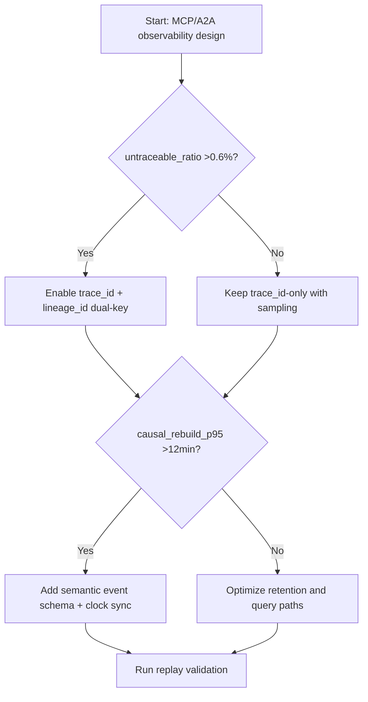
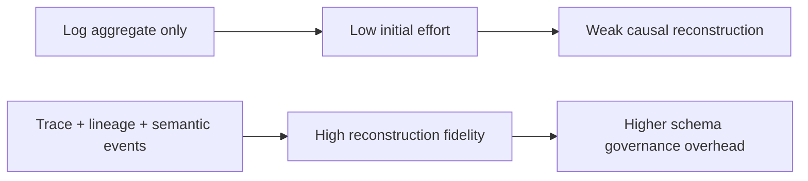
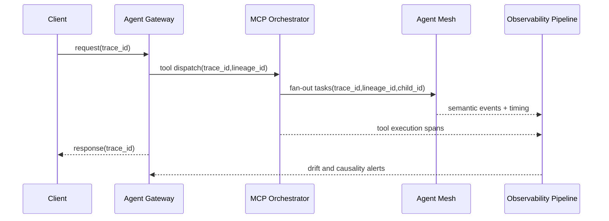

# Agent MCP/A2A Observability Correlation Lineage Selection FAQ (Azure AI Agent Infra)

## 1) 3-minute conclusions
- **When MCP/A2A flows span more than three execution planes and untraceable requests exceed 0.6%, enforce a dual-key model: `trace_id + span_lineage_id`.**
- **Log aggregation alone is not observability closure**: if causal-chain reconstruction P95 exceeds 12 minutes, add event-clock alignment and semantic tagging.
- **Production thresholds: end-to-end reconstruction success >=99.3% and cross-system clock drift <=250ms.**

## 2) Q1 / Q2 / Q3
- **Why can we see errors but not root cause?** Inconsistent fields and lost context between gateway/executor layers.
- **Why is A2A harder than single-agent debugging?** Parallel fan-out, retry branching, and nested tool execution explode causal trees.
- **Minimum viable loop?** Unified IDs, semantic event schema, time sync, and replay validation.

### Q1: When is lineage_id mandatory?
When median fan-out nodes per trace exceed 6 and parallel retries exist.

### Q2: When is trace_id-only acceptable?
Synchronous single-chain calls with no fan-out.

### Q3: How to quantify observability upgrades?
Compare MTTR reduction value with added telemetry/storage cost, targeting ROI > 1.

## 3) Mermaid diagrams
### 3.1 Decision tree

### 3.2 Path comparison

### 3.3 Sequence

## 4) Decision matrix
| Dimension | trace_id only | trace+lineage+semantic events (Recommended) |
|---|---:|---:|
| Root-cause latency P95 | 8–24 min | 2–9 min |
| Reconstruction success | 95.8%–98.9% | 99.3%–99.8% |
| Telemetry/storage cost | Low | Medium |
| Ops complexity (1-10) | 4 | 8 |
| Multi-agent parallel suitability | Medium-low | High |

## 5) Quant model + 7-card insights
- Reconstruction success: `RebuildRate = RebuiltFlows / TotalFlows`
- Observability ROI: `ROI = (MTTR_saved_value - Obs_extra_cost) / Obs_extra_cost`
- Example (`synthetic_assumed`):
  - `RebuiltFlows=19,860, TotalFlows=20,000`
  - `RebuildRate=99.3%`
  - `MTTR_saved_value=$4,200/month, Obs_extra_cost=$1,750/month`
  - `ROI=1.4`
- Evidence:
  - `workshops/azure-agent-infra/evidence/cycle-1455-benchmark.json`
  - `workshops/azure-agent-infra/evidence/cycle-1455-sources.json`
- Labels: `official/synthetic_assumed/not_measured`.

## 6) Production verification checklist
- [ ] `trace_id/lineage_id/child_id` is unified across gateway, MCP, A2A, and tools
- [ ] Semantic event dictionary is versioned with compatibility policy
- [ ] Time synchronization and drift alerts are enabled
- [ ] Replay tool can rebuild causal trees from dual keys
- [ ] FAQ and 7-card include source timestamps and labels
