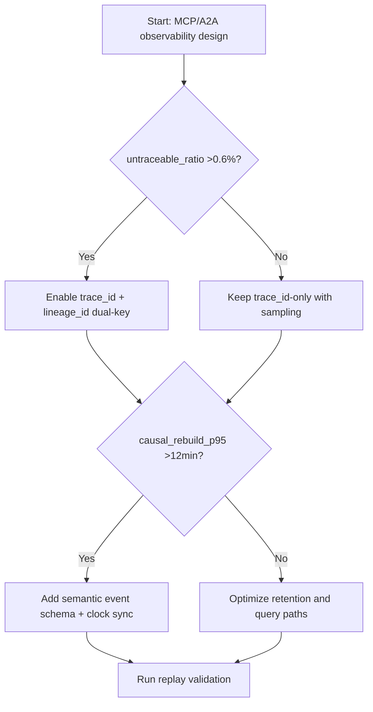
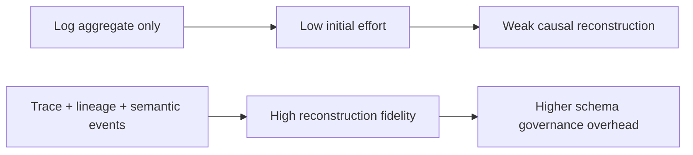
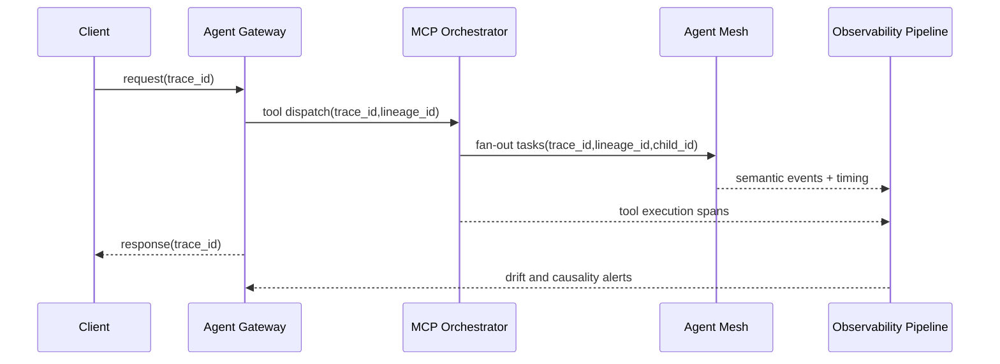

# Agent MCP/A2A Observability Correlation Lineage 选型 FAQ（Azure AI Agent Infra）

## 1) 3 分钟结论
- **当 MCP/A2A 链路跨 3 个以上执行面且“不可追溯请求”比例 >0.6% 时，必须采用统一 `trace_id + span_lineage_id` 双键模型**。
- **仅有日志聚合不等于可观测性闭环**：若因果链重建耗时 P95 >12 分钟，需要补齐事件时钟对齐与上下游语义标签。
- **生产阈值：端到端链路还原成功率 ≥99.3%，跨系统时间漂移 ≤250ms。**

## 2) Q1 / Q2 / Q3
- **为什么“看见报错”却定位不到根因？**：日志字段不统一、调用上下文在网关/执行器之间丢失。
- **为什么 A2A 比单代理更难排障？**：多代理并行、重试分叉、工具调用嵌套导致因果树爆炸。
- **最小可用闭环？**：统一 ID、语义事件规范、时间同步、回放追踪。

### Q1：何时必须引入 lineage_id？
当单 trace 下分叉任务节点数中位数 >6 且存在并行重试。

### Q2：何时仅 trace_id 足够？
单链路同步调用、无 fan-out 的轻量场景。

### Q3：如何量化观测改造收益？
比较 MTTR 降幅与新增采集/存储成本，目标是 ROI>1。

## 3) Mermaid 图
### 3.1 决策树

### 3.2 路径对比

### 3.3 时序

## 4) 决策矩阵
| 维度 | 仅 trace_id | trace+lineage+语义事件（推荐） |
|---|---:|---:|
| 根因定位 P95 | 8–24 分钟 | 2–9 分钟 |
| 链路还原成功率 | 95.8%–98.9% | 99.3%–99.8% |
| 采集存储成本 | 低 | 中 |
| 运维复杂度（1-10） | 4 | 8 |
| 适配多代理并行 | 中低 | 高 |

## 5) 定量算例与 7-Card 洞察
- 链路还原率：`RebuildRate = RebuiltFlows / TotalFlows`
- 观测 ROI：`ROI = (MTTR_saved_value - Obs_extra_cost) / Obs_extra_cost`
- 示例（`synthetic_assumed`）：
  - `RebuiltFlows=19,860, TotalFlows=20,000`
  - `RebuildRate=99.3%`
  - `MTTR_saved_value=$4,200/month, Obs_extra_cost=$1,750/month`
  - `ROI=1.4`
- 证据：
  - `workshops/azure-agent-infra/evidence/cycle-1455-benchmark.json`
  - `workshops/azure-agent-infra/evidence/cycle-1455-sources.json`
- 标签：`official/synthetic_assumed/not_measured`。

## 6) 生产核验 Checklist
- [ ] `trace_id/lineage_id/child_id` 字段在网关、MCP、A2A、工具层统一
- [ ] 事件语义字典版本化并有兼容策略
- [ ] 时间同步（NTP/PTP）与漂移告警阈值已上线
- [ ] 回放工具可基于双键重建因果树
- [ ] FAQ 与 7-Card 均含来源时间戳与标签
