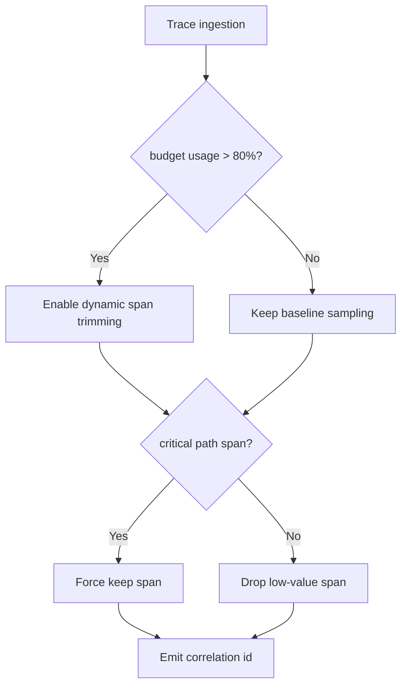
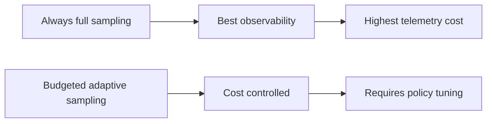
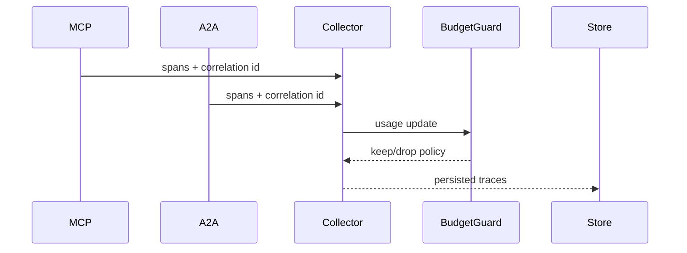

# Agent MCP-A2A Trace Correlation Budget Selection FAQ (Azure AI Agent Infra)

## 1) 3-minute conclusions
- **In mixed MCP+A2A orchestration, uncontrolled trace/span budgets directly inflate p95 latency and observability spend.**
- **Use layered sampling + forced critical-path retention + low-value span trimming.**
- **Targets: `trace_cost_per_session < $0.004`, `critical_span_loss=0`, `obs_overhead_p95 <35ms`.**

## 2) Q1 / Q2 / Q3
- **Why does budget explode?** Cross-runtime, cross-region paths default to high sampling.
- **Why not blanket downsampling?** It loses root-cause critical paths.
- **Minimum loop?** Critical whitelist + adaptive sampling + budget guard alerts.

### Q1: When to trigger trimming?
When budget burn prediction exceeds threshold.

### Q2: When to force full critical spans?
During incidents and replay windows.

### Q3: How to assess gain?
Compare observability savings against incident triage time.

## 3) Mermaid diagrams
### 3.1 Decision tree

### 3.2 Path comparison

### 3.3 Sequence

## 4) Decision matrix
| Dimension | Full sampling | Budgeted adaptive (Recommended) |
|---|---:|---:|
| Observability completeness | High | High (critical path) |
| Cost control | Low | High |
| Ops complexity (1-10) | 4 | 7 |
| RCA speed | High | Medium-high |
| Sustainability | Medium | High |

## 5) Quant model + 7-card insights
- Cost gain: `CostGain = BaselineObsCost - BudgetedObsCost`
- Critical loss: `CriticalLoss = LostCriticalSpans / TotalCriticalSpans`
- Example (`synthetic_assumed`):
  - `BaselineObsCost=$0.0092/session, BudgetedObsCost=$0.0038/session`
  - `CostGain=$0.0054/session`
  - `LostCriticalSpans=0, TotalCriticalSpans=82,000`
  - `CriticalLoss=0`
- Evidence:
  - `workshops/azure-agent-infra/evidence/cycle-1473-benchmark.json`
  - `workshops/azure-agent-infra/evidence/cycle-1473-sources.json`
- Labels: `official/synthetic_assumed/not_measured`.

## 6) Production verification checklist
- [ ] Critical-path span whitelist policy released
- [ ] Adaptive budget thresholds are configurable and auditable
- [ ] Correlation IDs are preserved across MCP/A2A chains
- [ ] Incident-window retention overrides are tested
- [ ] FAQ/7-card source labels are complete
