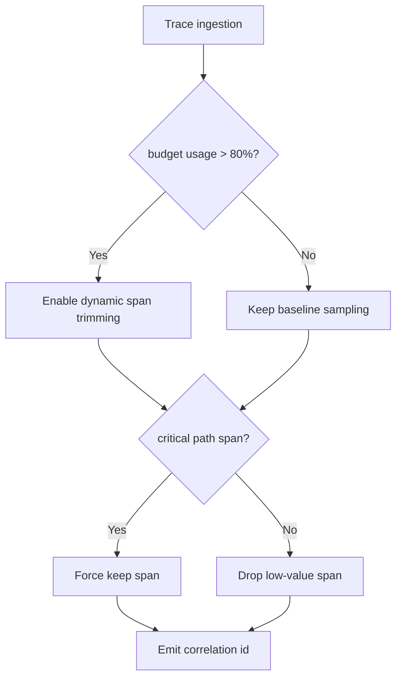
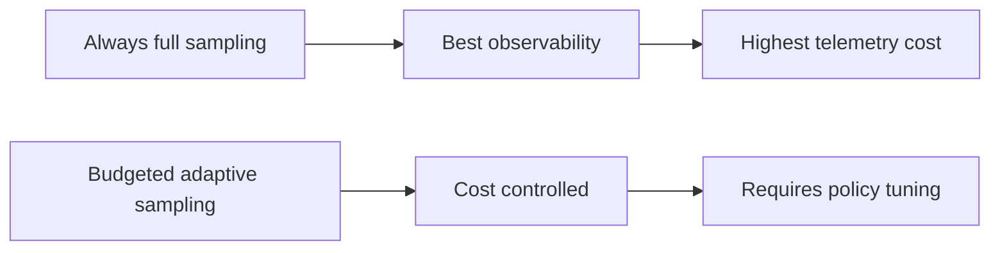
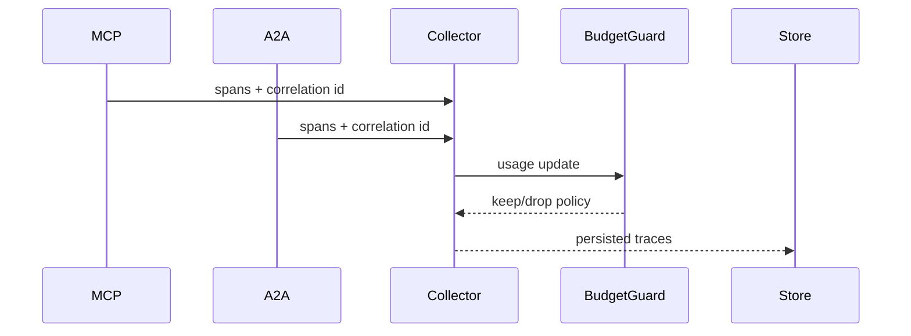

# Agent MCP-A2A Trace Correlation Budget 选型 FAQ（Azure AI Agent Infra）

## 1) 3 分钟结论
- **MCP 与 A2A 混合编排下，trace/span 预算失控会直接抬升 p95 延迟与观测成本。**
- **推荐“分层采样 + 关键路径强制保留 + 低值 span 剪裁”预算策略。**
- **目标阈值：`trace_cost_per_session < $0.004`、`critical_span_loss=0`、`obs_overhead_p95 <35ms`。**

## 2) Q1 / Q2 / Q3
- **为什么预算会爆？**：链路跨 runtime、跨 region，默认全量采样。
- **为什么不能一刀切降采样？**：会丢失根因定位关键路径。
- **最小闭环？**：关键链路白名单 + 动态采样 + 预算守卫告警。

### Q1：何时触发剪裁？
预算耗尽预测超过阈值时。

### Q2：何时恢复全量关键 span？
故障窗口与回放窗口内强制保留。

### Q3：如何评估收益？
比较观测成本下降与故障定位时长。

## 3) Mermaid 图
### 3.1 决策树

### 3.2 路径对比

### 3.3 时序

## 4) 决策矩阵
| 维度 | 全量采样 | 预算自适应（推荐） |
|---|---:|---:|
| 可观测完整性 | 高 | 高（关键路径） |
| 成本控制 | 低 | 高 |
| 运维复杂度（1-10） | 4 | 7 |
| 根因定位速度 | 高 | 中高 |
| 可持续性 | 中 | 高 |

## 5) 定量算例与 7-Card 洞察
- 成本收益：`CostGain = BaselineObsCost - BudgetedObsCost`
- 关键丢失率：`CriticalLoss = LostCriticalSpans / TotalCriticalSpans`
- 示例（`synthetic_assumed`）：
  - `BaselineObsCost=$0.0092/session, BudgetedObsCost=$0.0038/session`
  - `CostGain=$0.0054/session`
  - `LostCriticalSpans=0, TotalCriticalSpans=82,000`
  - `CriticalLoss=0`
- 证据：
  - `workshops/azure-agent-infra/evidence/cycle-1473-benchmark.json`
  - `workshops/azure-agent-infra/evidence/cycle-1473-sources.json`
- 标签：`official/synthetic_assumed/not_measured`。

## 6) 生产核验 Checklist
- [ ] 关键路径 span 白名单策略已发布
- [ ] 动态采样预算阈值可配置可审计
- [ ] correlation id 在 MCP/A2A 链路完整透传
- [ ] 故障窗口强制保留规则验证通过
- [ ] FAQ/7-Card 来源标签完整
