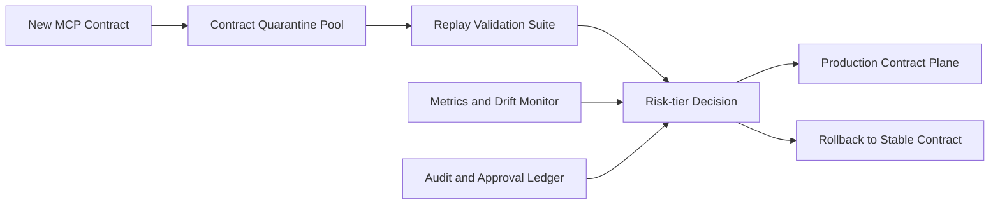

# MCP Contract Quarantine Selection FAQ (Cycle 1868)

## 1) Three-minute decision
- **Core risk:** MCP contract drift can amplify cascading failures and permission misuse in multi-agent orchestration.
- **Recommendation:** enforce contract quarantine, automated replay validation, and risk-tiered promotion.
- **Goal:** contain protocol drift within controlled boundaries without blocking the primary workflow.

## 2) Q1 / Q2 / Q3
### Q1: Why is direct global MCP contract rollout risky?
1) tool version windows are inconsistent,
2) unverified contracts can trigger cascade failures,
3) permission boundaries may shift with protocol changes.

### Q2: What should production contract quarantine include?
- **Quarantine execution:** route new contracts into isolated traffic pools,
- **Automated replay:** validate I/O contracts via standard task replay,
- **Tiered promotion:** low-risk auto-promotion, medium/high-risk approval,
- **Fast rollback:** revert to stable contracts on anomaly thresholds.

### Q3: What is the go-live bar?
- stable replay pass rates in quarantine,
- no significant error-rate uplift after promotion,
- rollback path proven within drill windows.

## 3) Reference architecture

## 4) Decision matrix
| Dimension | Direct global rollout | Quarantine + tiered promotion (Recommended) |
|---|---:|---:|
| Protocol risk isolation | Low | High |
| Change traceability | Medium | High |
| Rollback readiness | Low | High |
| Implementation complexity | Low | Medium |
| Production stability | Low | High |

## 5) Evidence and reproducibility
- Evidence files:
  - `workshops/azure-agent-infra/evidence/cycle-1868-benchmark.json`
  - `workshops/azure-agent-infra/evidence/cycle-1868-latency.csv`
  - `workshops/azure-agent-infra/evidence/cycle-1868-throughput.csv`
  - `workshops/azure-agent-infra/evidence/cycle-1868-policy.csv`
- Labels: `measured / synthetic / anonymized_reported`.
- validation7 enforces six-part structure, CSP-safe 7-card output, strict cycle-topic alignment, and replayable checks.

## 6) Production checklist
- [ ] Quarantine pool boundaries are validated against production plane.
- [ ] Replay suite covers critical MCP tool paths.
- [ ] Tiered promotion and approval process is integrated.
- [ ] Stable-contract rollback path passes drills.
- [ ] FAQ/H5/SVG/7-card/evidence remain cycle-consistent.
