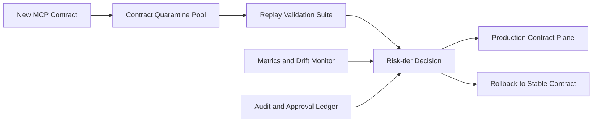

# MCP Contract Quarantine 选型 FAQ（Cycle 1868）

## 1) 3 分钟结论
- **核心风险：** MCP 工具协议偏移会在多代理协同中放大连锁失败与权限误用。
- **推荐方案：** “契约隔离区（quarantine）+ 自动回归验证 + 分级放行”机制。
- **目标：** 在不阻塞主流程的前提下，把协议漂移限制在可控边界内。

## 2) Q1 / Q2 / Q3
### Q1：为什么直接全量升级 MCP 合同有风险？
1) 多工具版本并存，兼容窗口不一致；
2) 未验证合同进入生产会触发级联故障；
3) 权限边界细节易被协议变更影响。

### Q2：生产级 contract quarantine 如何构建？
- **隔离区执行：** 新合同先进入隔离流量池；
- **自动回归：** 回放标准任务集验证输入/输出契约；
- **分级放行：** 低风险自动放行，中高风险人工签核；
- **快速回退：** 命中异常指标立即切回稳定合同。

### Q3：上线判据是什么？
- 隔离区回归通过率稳定；
- 放行后错误率无显著抬升；
- 回退链路在演练窗口内可用。

## 3) 架构图

## 4) 选型矩阵
| 维度 | 直接全量升级 | Quarantine + 分级放行（推荐） |
|---|---:|---:|
| 协议风险隔离 | 低 | 高 |
| 变更可追溯性 | 中 | 高 |
| 故障可回退性 | 低 | 高 |
| 实施复杂度 | 低 | 中 |
| 生产稳定性 | 低 | 高 |

## 5) 证据与复算口径
- 证据文件：
  - `workshops/azure-agent-infra/evidence/cycle-1868-benchmark.json`
  - `workshops/azure-agent-infra/evidence/cycle-1868-latency.csv`
  - `workshops/azure-agent-infra/evidence/cycle-1868-throughput.csv`
  - `workshops/azure-agent-infra/evidence/cycle-1868-policy.csv`
- 标签：`measured / synthetic / anonymized_reported`。
- validation7：六段结构、7-card CSP、cycle-topic 对齐、可回放验证链。

## 6) 生产检查清单
- [ ] 隔离区流量池与主平面边界已验证。
- [ ] 回归任务集覆盖核心 MCP 工具路径。
- [ ] 分级放行策略与审批流程联调通过。
- [ ] 稳定合同回退链路演练通过。
- [ ] FAQ/H5/SVG/7-card/evidence 轮次一致。
