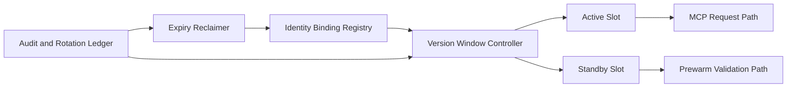

# MCP Identity Bindings Rotation Selection FAQ (Cycle 1883)

## 1) Three-minute decision
- **Core issue:** long-lived MCP identity bindings accumulate permission drift and credential exposure risk.
- **Recommendation:** versioned bindings, dual-slot rotation, and controlled expiry reclamation windows.
- **Goal:** continuously reduce identity risk without interrupting tool-call continuity.

## 2) Q1 / Q2 / Q3
### Q1: Why is simple periodic key replacement insufficient?
1) client/server cutovers are often unsynchronized,
2) stale bindings may remain active,
3) rollback scenarios need a safe standby slot.

### Q2: How should production identity binding rotation be designed?
- **Versioned bindings:** each binding carries version and activation window,
- **Dual-slot rotation:** active/standby parallelism with prewarm before cutover,
- **Expiry reclaim:** controlled deactivation and audited archival,
- **Failure rollback:** automatic fallback to previous safe version.

### Q3: What is the go-live bar?
- stable call success across rotation windows,
- sufficient stale-binding deactivation coverage,
- rollback completion within the defined window.

## 3) Reference architecture

## 4) Decision matrix
| Dimension | Periodic replacement | Versioned dual-slot rotation (Recommended) |
|---|---:|---:|
| Continuity availability | Medium | High |
| Security convergence speed | Medium | High |
| Rollback controllability | Low | High |
| Implementation complexity | Low | Medium |
| Auditability | Medium | High |

## 5) Evidence and reproducibility
- Evidence files:
  - `workshops/azure-agent-infra/evidence/cycle-1883-benchmark.json`
  - `workshops/azure-agent-infra/evidence/cycle-1883-latency.csv`
  - `workshops/azure-agent-infra/evidence/cycle-1883-throughput.csv`
  - `workshops/azure-agent-infra/evidence/cycle-1883-policy.csv`
- Labels: `measured / synthetic / anonymized_reported`.
- validation7 enforces six-part structure, CSP-safe 7-card output, strict cycle-topic alignment, and replayable checks.

## 6) Production checklist
- [ ] Binding versions and activation windows are configured.
- [ ] Dual-slot prewarm and cutover drills pass.
- [ ] Expired binding reclamation is auditable.
- [ ] Failure rollback completes within the window.
- [ ] FAQ/H5/SVG/7-card/evidence remain cycle-consistent.
