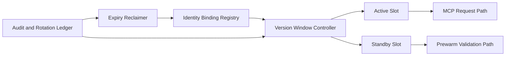

# MCP Identity Bindings Rotation 选型 FAQ（Cycle 1883）

## 1) 3 分钟结论
- **核心问题：** MCP 工具身份绑定长期不轮换会积累权限漂移与密钥暴露风险。
- **推荐方案：** “绑定版本化 + 双槽轮换 + 失效回收窗口”三段治理。
- **目标：** 在不中断工具调用的前提下，持续降低身份与凭据风险面。

## 2) Q1 / Q2 / Q3
### Q1：为什么简单定时换密钥不足？
1) 调用端与服务端切换节奏不一致；
2) 旧绑定残留可能继续生效；
3) 回滚场景缺少安全缓冲槽。

### Q2：生产级 identity binding rotation 如何设计？
- **绑定版本化：** 每个绑定携带版本和生效窗口；
- **双槽轮换：** active/standby 并行，先预热后切主；
- **失效回收：** 到期绑定进入受控失效与审计归档；
- **异常回滚：** 轮换失败自动回退到前一安全版本。

### Q3：上线判据是什么？
- 轮换窗口内调用成功率稳定；
- 旧绑定失效覆盖率达标；
- 轮换异常可在窗口内完成回滚。

## 3) 架构图

## 4) 选型矩阵
| 维度 | 定时替换 | 版本化双槽轮换（推荐） |
|---|---:|---:|
| 连续可用性 | 中 | 高 |
| 安全收敛速度 | 中 | 高 |
| 回滚可控性 | 低 | 高 |
| 实施复杂度 | 低 | 中 |
| 可审计性 | 中 | 高 |

## 5) 证据与复算口径
- 证据文件：
  - `workshops/azure-agent-infra/evidence/cycle-1883-benchmark.json`
  - `workshops/azure-agent-infra/evidence/cycle-1883-latency.csv`
  - `workshops/azure-agent-infra/evidence/cycle-1883-throughput.csv`
  - `workshops/azure-agent-infra/evidence/cycle-1883-policy.csv`
- 标签：`measured / synthetic / anonymized_reported`。
- validation7：六段结构、7-card CSP、cycle-topic 对齐、验证链可回放。

## 6) 生产检查清单
- [ ] 绑定版本号与生效窗口策略已配置。
- [ ] 双槽预热与切换演练通过。
- [ ] 到期绑定回收与审计链路可追溯。
- [ ] 异常回滚路径在窗口内可完成。
- [ ] FAQ/H5/SVG/7-card/evidence 轮次一致。
