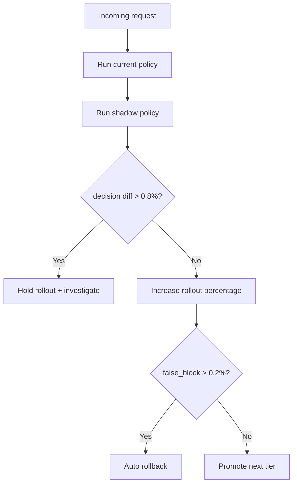
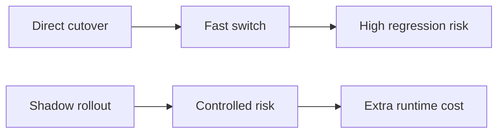
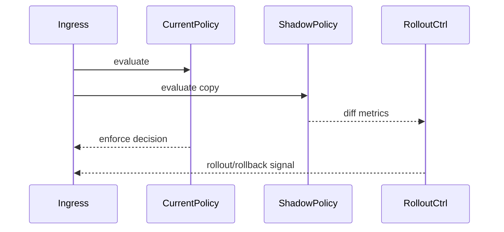

# Agent MCP Policy Engine Shadow Rollout Selection FAQ (Azure AI Agent Infra)

## 1) 3-minute conclusions
- **Direct MCP policy-engine cutover is risky; shadow rollout greatly reduces false-block incidents.**
- **Use shadow compare + diff threshold gating + staged ramp-up.**
- **Targets: `policy_diff_rate <0.8%`, `false_block <0.2%`, `rollback_p95 <90s`.**

## 2) Q1 / Q2 / Q3
- **Why shadow first?** Compare new/old policy decisions before affecting production.
- **Why not shadow forever?** Long dual-run adds cost and latency overhead.
- **Minimum loop?** Diff sampling, threshold gate, auto rollback.

### Q1: When to ramp up?
When diff and false-block rates stay below thresholds.

### Q2: When to rollback?
When false blocks or policy drift breach limits.

### Q3: How to quantify gains?
Compare incident reduction against extra runtime overhead.

## 3) Mermaid diagrams
### 3.1 Decision tree

### 3.2 Path comparison

### 3.3 Sequence

## 4) Decision matrix
| Dimension | Direct cutover | Shadow rollout (Recommended) |
|---|---:|---:|
| Risk control | Low | High |
| Release speed | High | Medium |
| Ops complexity (1-10) | 4 | 8 |
| Rollback control | Medium | High |
| Observability | Medium | High |

## 5) Quant model + 7-card insights
- Diff rate: `DiffRate = DiffDecisions / TotalDecisions`
- Risk gain: `IncidentGain = BaselineIncidents - ShadowIncidents`
- Example (`synthetic_assumed`):
  - `DiffDecisions=612, TotalDecisions=96,000`
  - `DiffRate=0.64%`
  - `BaselineIncidents=7, ShadowIncidents=1`
  - `IncidentGain=6`
- Evidence:
  - `workshops/azure-agent-infra/evidence/cycle-1480-benchmark.json`
  - `workshops/azure-agent-infra/evidence/cycle-1480-sources.json`
- Labels: `official/synthetic_assumed/not_measured`.

## 6) Production verification checklist
- [ ] Shadow comparison path is fully observable
- [ ] Diff/false-block thresholds are configurable
- [ ] Auto-rollback path drill is validated
- [ ] Ramp schedule and approvals are recorded
- [ ] FAQ/7-card source labels are complete
