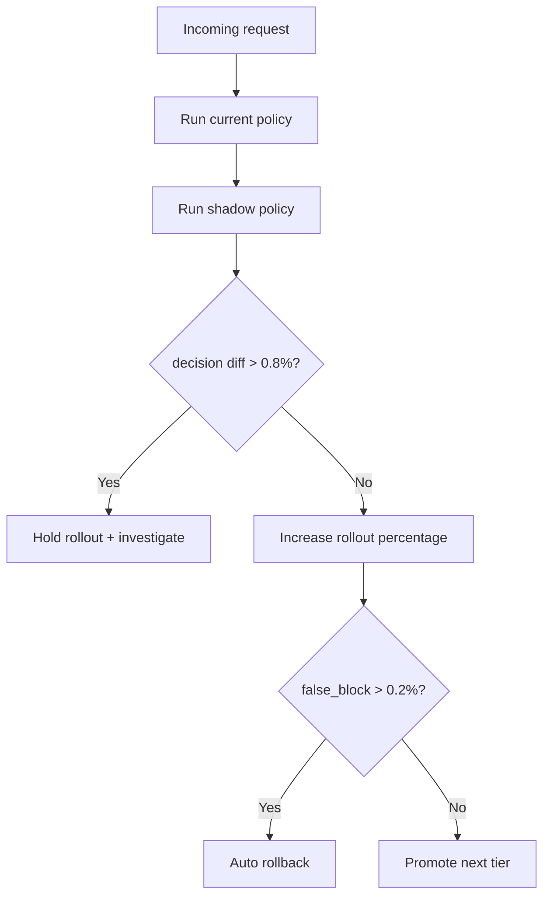
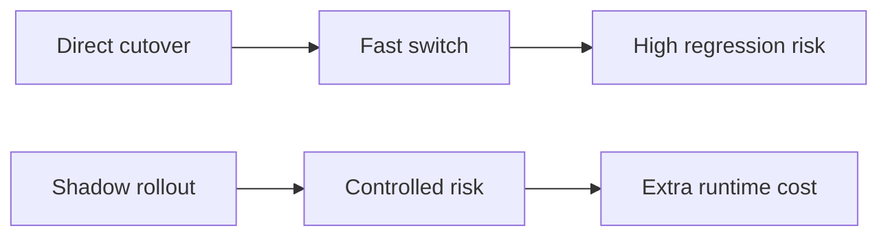
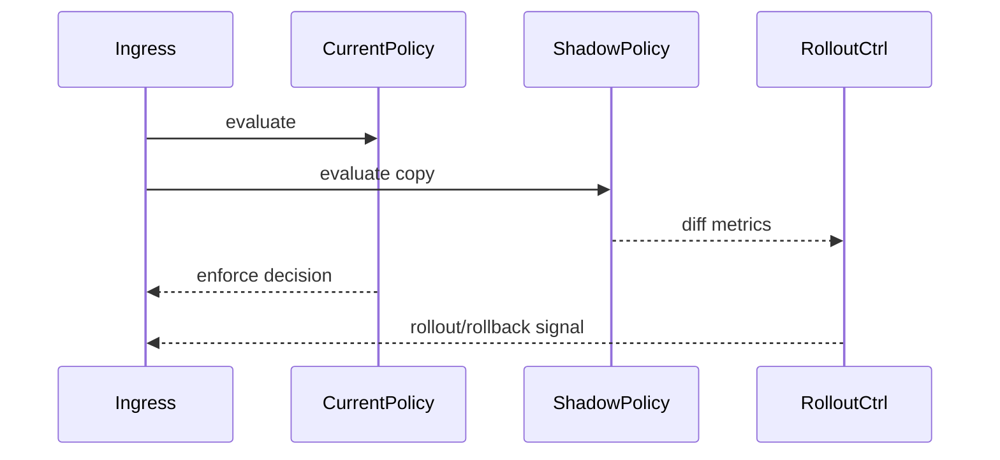

# Agent MCP Policy Engine Shadow Rollout 选型 FAQ（Azure AI Agent Infra）

## 1) 3 分钟结论
- **MCP 策略引擎直接切主线风险高，影子发布可显著降低误拦截事故。**
- **推荐“shadow compare + 差异阈值门控 + 分层放量”策略。**
- **目标阈值：`policy_diff_rate <0.8%`、`false_block <0.2%`、`rollback_p95 <90s`。**

## 2) Q1 / Q2 / Q3
- **为何要 shadow？**：先比较新旧决策差异，避免直接影响生产流量。
- **为何不能无限 shadow？**：长期双跑有成本与决策延迟开销。
- **最小闭环？**：差异采样、阈值门控、自动回滚。

### Q1：何时允许放量？
差异率与误拦截率持续低于阈值。

### Q2：何时触发回滚？
误拦截或策略漂移超阈值。

### Q3：如何量化收益？
比较事故率下降与额外开销。

## 3) Mermaid 图
### 3.1 决策树

### 3.2 路径对比

### 3.3 时序

## 4) 决策矩阵
| 维度 | 直接切换 | Shadow 发布（推荐） |
|---|---:|---:|
| 风险控制 | 低 | 高 |
| 发布速度 | 高 | 中 |
| 运维复杂度（1-10） | 4 | 8 |
| 回滚可控性 | 中 | 高 |
| 可观测性 | 中 | 高 |

## 5) 定量算例与 7-Card 洞察
- 差异率：`DiffRate = DiffDecisions / TotalDecisions`
- 风险收益：`IncidentGain = BaselineIncidents - ShadowIncidents`
- 示例（`synthetic_assumed`）：
  - `DiffDecisions=612, TotalDecisions=96,000`
  - `DiffRate=0.64%`
  - `BaselineIncidents=7, ShadowIncidents=1`
  - `IncidentGain=6`
- 证据：
  - `workshops/azure-agent-infra/evidence/cycle-1480-benchmark.json`
  - `workshops/azure-agent-infra/evidence/cycle-1480-sources.json`
- 标签：`official/synthetic_assumed/not_measured`。

## 6) 生产核验 Checklist
- [ ] shadow 对比链路完整可观测
- [ ] 差异率/误拦截阈值可配置
- [ ] 自动回滚路径演练通过
- [ ] 放量节奏与审批机制记录齐全
- [ ] FAQ/7-Card 来源标签完整
