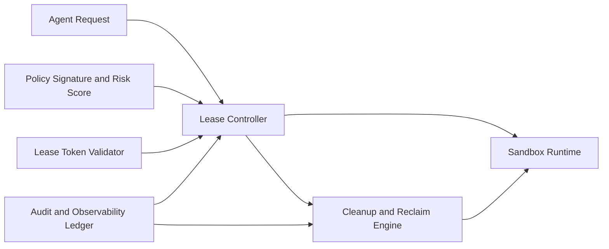

# MCP Policy Sandbox Lease Governance Selection FAQ (Cycle 1848)

## 1) Three-minute decision
- **Core tradeoff:** short sandbox leases increase rebuild jitter, while long leases increase residual-state and over-permission risk.
- **Recommendation:** tiered leases (short by default plus controlled extension), policy-bound renewal tokens, and deterministic expiry reclamation.
- **Goal:** preserve strong isolation boundaries while reducing unnecessary cold-start overhead.

## 2) Q1 / Q2 / Q3
### Q1: Why is fixed long-lease strategy risky?
1) long leases widen residual-state exposure windows,
2) privilege context lives too long and weakens auditability,
3) stale sessions consume capacity and cost when not reclaimed quickly.

### Q2: What production-grade lease-governance design should be used?
- **Tiered lease policy:** short default lease with task-trust-based extension caps,
- **Token binding:** renewal requires signed policy and trace evidence,
- **Expiry reclaim:** force-clean caches, credentials, and temp volumes at lease end,
- **Anomaly breaker:** switch to fresh sandbox on repeated renewal failures or risk spikes.

### Q3: How do we validate lease-policy quality?
- balanced cold-start overhead and renewal success rate,
- fewer cross-session residue incidents,
- session cost and capacity usage inside budget bands.

## 3) Reference architecture

## 4) Decision matrix
| Dimension | Fixed long lease | Tiered lease + deterministic reclaim (Recommended) |
|---|---:|---:|
| Isolation safety | Low | High |
| Latency stability | Medium | High |
| Cost control | Low | High |
| Implementation complexity | Low | Medium |
| Compliance auditability | Low | High |

## 5) Evidence and reproducibility
- Evidence files:
  - `workshops/azure-agent-infra/evidence/cycle-1848-benchmark.json`
  - `workshops/azure-agent-infra/evidence/cycle-1848-latency.csv`
  - `workshops/azure-agent-infra/evidence/cycle-1848-throughput.csv`
  - `workshops/azure-agent-infra/evidence/cycle-1848-policy.csv`
- Labels: `measured / synthetic / anonymized_reported`.
- validation7 enforces bilingual six-part structure, CSP self-contained 7-card output, strict cycle-evidence alignment, and replayability.

## 6) Production checklist
- [ ] Tiered lease limits are active by task trust level.
- [ ] Renewal-token signature and risk checks are integrated.
- [ ] Expiry reclaim cleans cache, credentials, and temp volumes.
- [ ] Anomaly lease-breaker cutover is replay-verified.
- [ ] FAQ/H5/SVG/7-card align with cycle evidence.
