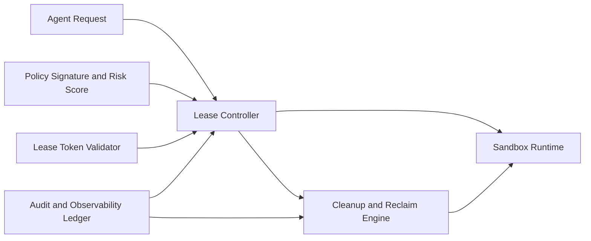

# MCP 策略沙箱租约治理选型 FAQ（Cycle 1848）

## 1) 3 分钟结论
- **核心矛盾：** 沙箱租约过短会增加重建抖动与延迟，过长会放大跨任务残留状态与越权风险。
- **推荐：** 分级租约（短租默认 + 受控续租）+ 策略绑定令牌 + 到期强回收。
- **目标：** 在保持隔离边界的同时减少不必要冷启动开销。

## 2) Q1 / Q2 / Q3
### Q1：为什么“固定长租约”在生产中风险高？
1) 长租约会扩大状态残留窗口，增加租户间污染概率；
2) 权限上下文存活过久，审计与追责困难；
3) 异常会话不及时回收会推高成本与容量占用。

### Q2：生产级沙箱租约治理应如何设计？
- **分级租约：** 默认短租约，按任务可信级与类型决定续租上限；
- **令牌绑定：** 续租必须携带策略签名与调用链证据；
- **到期回收：** 到期后强制清理缓存、凭据和临时卷；
- **异常熔断：** 连续续租失败或风险升高立即切换新沙箱。

### Q3：如何验证租约策略有效？
- 冷启动增量与续租成功率达到目标平衡；
- 跨会话残留事件显著下降；
- 单会话成本与资源占用在预算区间内。

## 3) 架构图

## 4) 选型矩阵
| 维度 | 固定长租约 | 分级租约 + 强回收（推荐） |
|---|---:|---:|
| 隔离安全性 | 低 | 高 |
| 时延稳定性 | 中 | 高 |
| 成本可控性 | 低 | 高 |
| 实施复杂度 | 低 | 中 |
| 合规审计 | 低 | 高 |

## 5) 证据与复算口径
- 证据文件：
  - `workshops/azure-agent-infra/evidence/cycle-1848-benchmark.json`
  - `workshops/azure-agent-infra/evidence/cycle-1848-latency.csv`
  - `workshops/azure-agent-infra/evidence/cycle-1848-throughput.csv`
  - `workshops/azure-agent-infra/evidence/cycle-1848-policy.csv`
- 标签：`measured / synthetic / anonymized_reported`。
- validation7：双语六段结构、7-card CSP 自包含、轮次与 evidence 一致、可回放链路通过。

## 6) 生产检查清单
- [ ] 分级租约与续租上限已按任务等级生效。
- [ ] 续租令牌签名校验与风险判定联调通过。
- [ ] 到期强回收覆盖缓存、凭据与临时卷。
- [ ] 异常租约熔断切换链路可回放。
- [ ] FAQ/H5/SVG/7-card 与 evidence 轮次一致。
