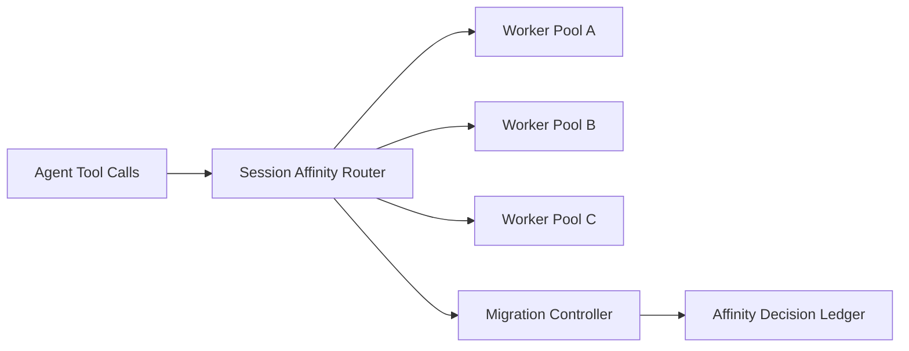

# Agent MCP Session Affinity Selection FAQ (Cycle 1799)

## 1) Three-minute decision
- **MCP tool instability is often caused by session drift rather than tool unavailability itself.**
- **Recommendation:** session-affinity routing + short leases + fast failover migration.
- **Goal:** reduce cross-session context loss, lower handshake rebuild cost, and stabilize call latency.

## 2) Core questions (Q1/Q2/Q3)
### Q1: Why does non-affine scheduling jitter?
1) connection context is rebuilt too often,
2) cache-hit rate drops and latency amplifies,
3) state migration lacks consistency boundaries.

### Q2: What is a practical affinity model?
- bind requests by session key at ingress,
- attach lease TTL and health probes,
- perform ordered migration with context replay on failure,
- co-optimize affinity and balancing to avoid permanent hotspots.

### Q3: How to validate effectiveness?
- fewer tool reconnects,
- stable P95 call latency,
- lower migration failure/context-loss rates.

## 3) Reference architecture

## 4) Decision matrix
| Dimension | Non-affine random routing | Affinity + lease migration (Recommended) |
|---|---:|---:|
| Context continuity | Low | High |
| Latency stability | Medium | High |
| Failover determinism | Medium | High |
| Operational complexity | Low | Medium |
| Cost controllability | Medium | High |

## 5) Evidence and reproducibility
- Evidence files:
  - `workshops/azure-agent-infra/evidence/cycle-1799-benchmark.json`
  - `workshops/azure-agent-infra/evidence/cycle-1799-latency.csv`
  - `workshops/azure-agent-infra/evidence/cycle-1799-throughput.csv`
  - `workshops/azure-agent-infra/evidence/cycle-1799-policy.csv`
- Labels: `measured / synthetic / anonymized_reported`.
- validation7 requires bilingual structure fidelity, CSP self-contained cards, cycle-consistent evidence, and replayability checks.

## 6) Production checklist
- [ ] Session-key routing and lease TTL are configured.
- [ ] Health probes and migration strategy are exercised.
- [ ] Context replay during migration is idempotent.
- [ ] Affinity hotspot monitoring and shedding rules are active.
- [ ] FAQ/H5/SVG/7-card align with cycle evidence.
