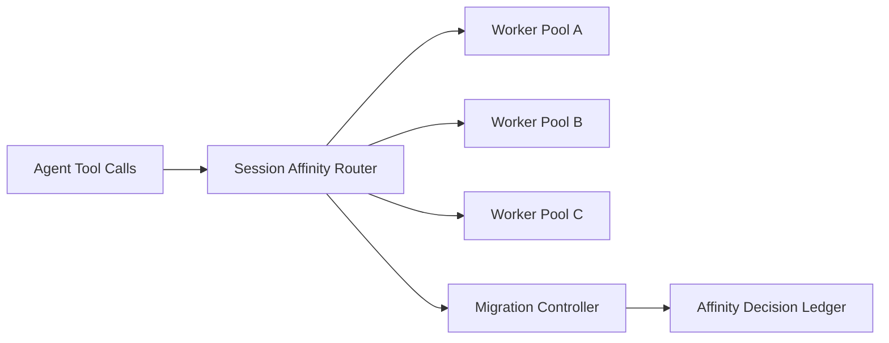

# Agent MCP 会话亲和选型 FAQ（Cycle 1799）

## 1) 3 分钟结论
- **MCP 工具稳定性问题常由“会话漂移”导致，而非工具本身不可用。**
- **推荐：** 会话亲和路由 + 短期租约 + 失效快速迁移三段式。
- **目标：** 降低跨会话上下文丢失、减少工具握手重建成本，并稳定调用时延。

## 2) 关键问题（Q1/Q2/Q3）
### Q1：为什么无亲和调度会抖动？
1) 工具连接上下文频繁重建；
2) 缓存命中下降导致延迟放大；
3) 状态迁移缺乏一致性边界。

### Q2：可落地亲和方案？
- 入口按会话键做初始绑定；
- 绑定附带租约 TTL 与健康探测；
- 节点失效触发有序迁移和上下文重放；
- 亲和与负载均衡联合决策，避免热点长期固化。

### Q3：如何验证策略有效？
- 工具重连次数下降；
- P95 调用时延稳定；
- 迁移失败率与上下文丢失率下降。

## 3) 架构图

## 4) 选型矩阵
| 维度 | 无亲和随机路由 | 亲和+租约迁移（推荐） |
|---|---:|---:|
| 上下文连续性 | 低 | 高 |
| 时延稳定性 | 中 | 高 |
| 失效恢复确定性 | 中 | 高 |
| 运维复杂度 | 低 | 中 |
| 成本可控性 | 中 | 高 |

## 5) 证据与复算口径
- 证据文件：
  - `workshops/azure-agent-infra/evidence/cycle-1799-benchmark.json`
  - `workshops/azure-agent-infra/evidence/cycle-1799-latency.csv`
  - `workshops/azure-agent-infra/evidence/cycle-1799-throughput.csv`
  - `workshops/azure-agent-infra/evidence/cycle-1799-policy.csv`
- 标签：`measured / synthetic / anonymized_reported`。
- validation7：双语结构、CSP 自包含、证据一致、可回放链路校验通过。

## 6) 生产检查清单
- [ ] 会话键路由与租约 TTL 已配置。
- [ ] 健康探测与迁移策略已演练。
- [ ] 迁移期间上下文重放具幂等保障。
- [ ] 亲和热点监控与削峰规则生效。
- [ ] FAQ/H5/SVG/7-card 与 evidence 轮次一致。
