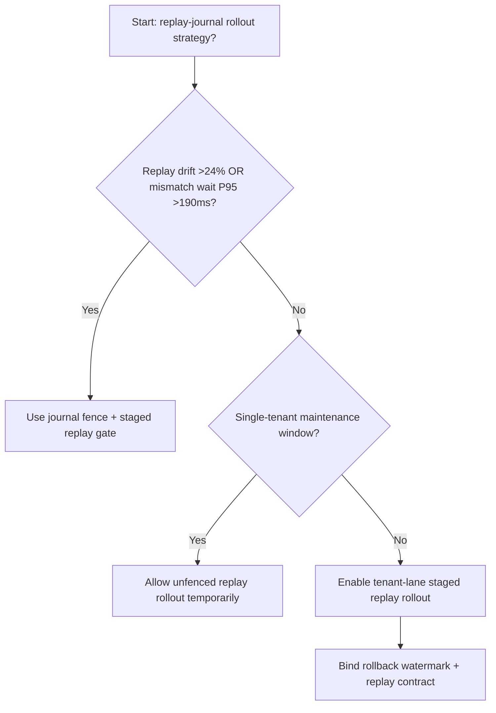
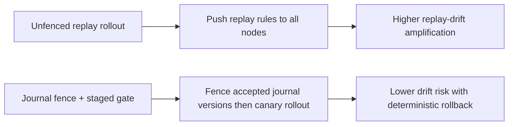
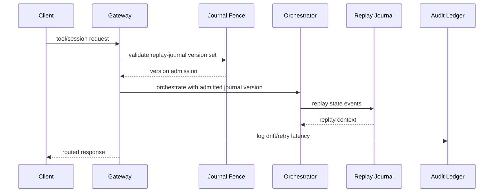

# Agent MCP Session Replay Journal Fence Selection FAQ (Unfenced Replay Rollout vs Journal Fence + Staged Replay Gate)

## 1) Core conclusions (for decision-makers first)
- **When MCP session replay drift exceeds 24% and version-mismatch wait P95 exceeds 190ms, production should default to Journal Fence + Staged Replay Gate**.
- **When unfenced replay drift exceeds 12% and replay retry P95 exceeds 260ms, Unfenced Replay Rollout enters the 12.9% drift amplification band**.
- **Multi-tenant orchestration must bind journal fence, rollout batches, and rollback watermarks**, or cross-session replay consistency destabilizes.

## 2) Q1 / Q2 / Q3 (plain-language definitions first)
- **Unfenced Replay Rollout**: push new replay rules to all session nodes directly; fast but risky.
- **Journal Fence + Staged Replay Gate**: constrain accepted replay-journal versions first, then shift traffic in batches.

### Q1: Why does replay-journal versioning affect agent stability?
First principles: MCP tool orchestration depends on consistent session-state replay. Version drift makes equivalent requests resolve with diverged context, amplifying retries and tail latency.

### Q2: When is Unfenced Replay Rollout acceptable temporarily?
Only in single-tenant low-traffic maintenance windows. Multi-tenant production should default to journal fencing.

### Q3: What is the minimum safe loop?
Version sampling -> fence validation -> staged rollout -> drift alerts -> automated rollback.

## 3) Mermaid (decision tree / path comparison / sequence)
### 3.1 Selection decision tree

### 3.2 Path comparison

### 3.3 Runtime sequence

## 4) Decision matrix
| Dimension | Unfenced Replay Rollout | Journal Fence + Staged Replay Gate |
|---|---|---|
| Implementation complexity | Low | Medium |
| Replay-drift risk | High | Low |
| Multi-tenant controllability | Low | High |
| Rollback determinism | Medium | High |
| Default production fit | Maintenance windows only | Long-term default |

## 5) Evidence contract + recomputable examples (n/denominator/source)
> Percentages in this section are `synthetic_assumed` hypothetical examples for mechanism comparison; production mechanism validation remains `not_measured`.  
> Contract fields: `workshops/azure-agent-infra/evidence/cycle-543-benchmark.json` -> `percentage_contract`.

- Metric A (unfenced replay drift rate)  
  - Formula: `n_unfenced_replay_drift / n_gateway_requests_observed`  
  - Value: `568/4410 = 12.9%` (`synthetic_assumed`)  
  - Path: `percentage_contract.unfenced_replay_drift_rate`
- Metric B (journal-fence drift rate)  
  - Formula: `n_journal_fence_drift / n_gateway_requests_observed`  
  - Value: `238/4410 = 5.4%` (`synthetic_assumed`)  
  - Path: `percentage_contract.journal_fence_drift_rate`
- Metric C (recovery gain, percentage points)  
  - Formula: `(n_recovered_journal_fence - n_recovered_unfenced) / n_gateway_requests_observed`  
  - Value: `(4110-3776)/4410 = 7.6 percentage points` (`synthetic_assumed`)  
  - Path: `percentage_contract.journal_fence_recovery_gain_pts`

## 6) Production checklist
- [ ] Every tenant has replay-journal version allow-lists and rollout batches
- [ ] Drift rate, retry latency, and rollback success are observable and auditable
- [ ] Change flow supports canary rollout, fast rollback, and tiered promotion
- [ ] All metrics are tagged `synthetic_assumed`; production validation remains `not_measured`
