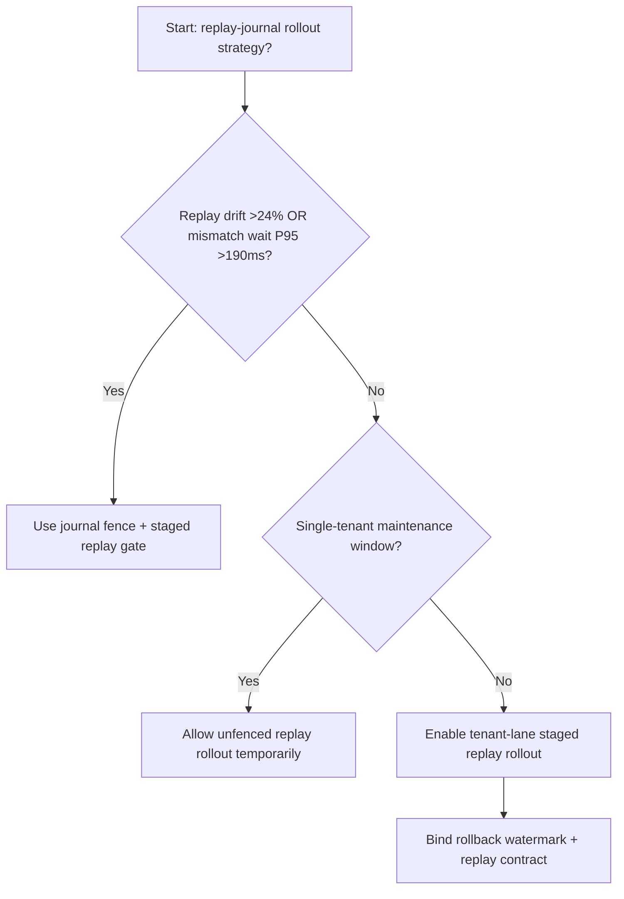
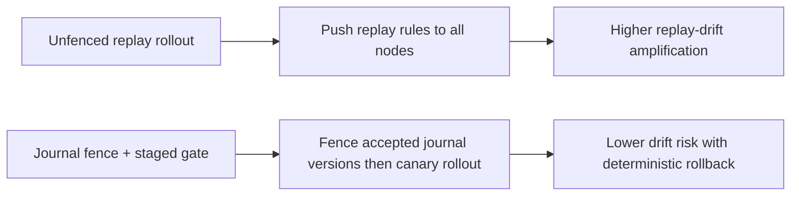
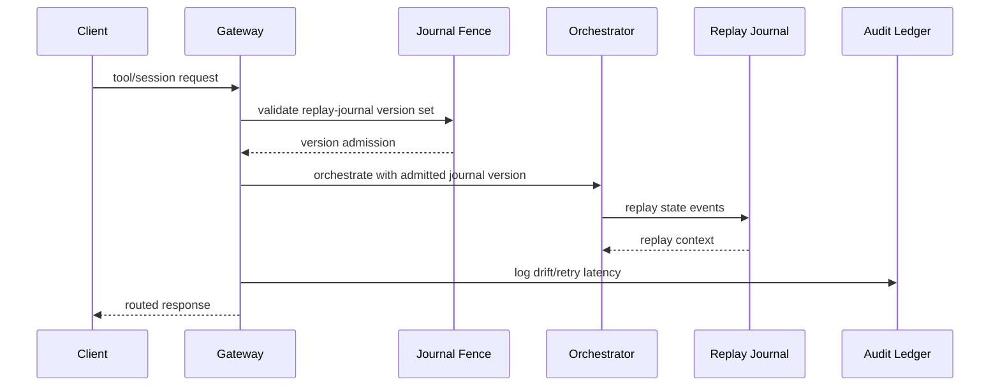

# Agent MCP Session Replay Journal Fence 选型 FAQ（Unfenced Replay Rollout vs Journal Fence + Staged Replay Gate）

## 1) 核心结论（先给负责人）
- **当 MCP 会话回放漂移率 >24% 且版本失配等待 P95 >190ms 时，生产默认应启用 Journal Fence + Staged Replay Gate**。
- **当未围栏回放漂移率 >12% 且回放重试 P95 >260ms 时，Unfenced Replay Rollout 会进入 12.9% 漂移放大区间**。
- **多租户编排必须把“日志围栏、灰度批次、回滚阈值”绑定执行**，否则跨会话重放一致性会抖动失稳。

## 2) Q1 / Q2 / Q3（术语先通俗解释）
- **Unfenced Replay Rollout**：直接把新回放规则推到所有会话节点，快但风险高。
- **Journal Fence + Staged Replay Gate**：先限定可接受回放日志版本，再按批次切流。

### Q1：为什么回放日志版本会影响 Agent 稳定性？
第一性原理：MCP 工具编排依赖一致的会话状态回放。版本漂移会让同请求在不同节点得到不同上下文，放大重试与尾延迟。

### Q2：什么时候可以短时用 Unfenced Replay Rollout？
仅限单租户低流量维护窗；多租户生产应默认开启日志围栏。

### Q3：最小闭环是什么？
版本采样 -> 围栏比对 -> 分批放量 -> 漂移告警 -> 自动回滚。

## 3) Mermaid（决策树 / 路径对比 / 时序）
### 3.1 选型决策树

### 3.2 路径对比图

### 3.3 运行时序图

## 4) 选型决策矩阵
| 维度 | Unfenced Replay Rollout | Journal Fence + Staged Replay Gate |
|---|---|---|
| 实现复杂度 | 低 | 中 |
| 回放漂移风险 | 高 | 低 |
| 多租户可控性 | 低 | 高 |
| 回滚确定性 | 中 | 高 |
| 生产默认建议 | 仅维护窗 | 长期默认 |

## 5) 数据证据与可复算算例（含 n/分母/来源）
> 本节百分比为 `synthetic_assumed` 假设算例（hypothetical），用于机制比较；生产机制认证保持 `not_measured`。  
> 合同字段见：`workshops/azure-agent-infra/evidence/cycle-543-benchmark.json` 的 `percentage_contract`。

- 指标 A（未围栏回放漂移率）  
  - 定义：`n_unfenced_replay_drift / n_gateway_requests_observed`  
  - 值：`568/4410 = 12.9%`（`synthetic_assumed`）  
  - 路径：`percentage_contract.unfenced_replay_drift_rate`
- 指标 B（日志围栏漂移率）  
  - 定义：`n_journal_fence_drift / n_gateway_requests_observed`  
  - 值：`238/4410 = 5.4%`（`synthetic_assumed`）  
  - 路径：`percentage_contract.journal_fence_drift_rate`
- 指标 C（恢复增益，百分点）  
  - 定义：`(n_recovered_journal_fence - n_recovered_unfenced) / n_gateway_requests_observed`  
  - 值：`(4110-3776)/4410 = 7.6` 个百分点（`synthetic_assumed`）  
  - 路径：`percentage_contract.journal_fence_recovery_gain_pts`

## 6) 生产 Checklist（上线前必须打勾）
- [ ] 每租户都有回放日志版本白名单与切流批次
- [ ] 漂移率、重试时延、回滚成功率可观测可审计
- [ ] 支持灰度、快速回退与分层放量
- [ ] 指标全部标注 `synthetic_assumed`，生产机制认证保持 `not_measured`
