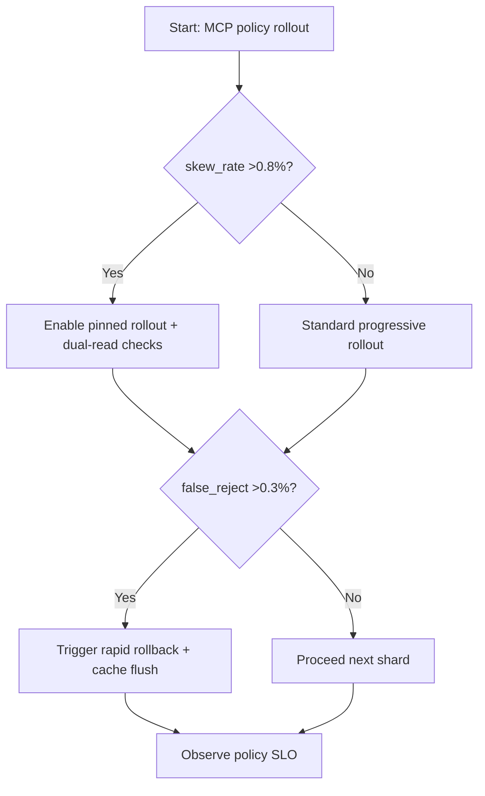
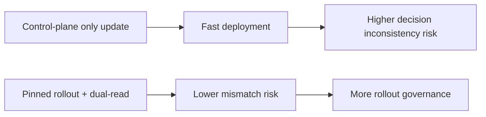
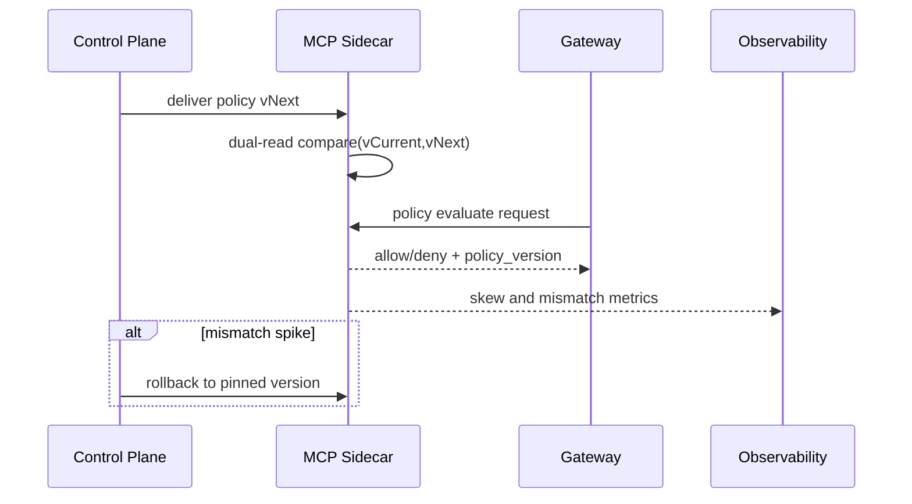

# Agent MCP Sidecar Policy Version-Skew Guard Selection FAQ (Azure AI Agent Infra)

## 1) 3-minute conclusions
- **If sidecar policy skew exceeds 0.8% or false-reject error exceeds 0.3%, enforce pinned rollout + dual-read verification + staged rollback.**
- **Updating control plane only without data-plane consistency checks causes same-request different-verdict behavior in MCP tooling.**
- **Targets: `policy_skew_rate <0.2%`, `rollback_p95 <60s`, `policy_eval_p95 <25ms`.**

## 2) Q1 / Q2 / Q3
- **Why “ghost rejects” happen?** Sidecar cache lag or policy distribution loss.
- **Why dual-read?** It compares old/new policy verdicts during migration windows to prevent false blocks.
- **Minimum viable loop?** Version propagation, layered rollout, mismatch alerts, fast rollback.

### Q1: When must rollout freeze?
When cross-node policy mismatch persists for two 5-minute windows and impacts critical tenants.

### Q2: When is fast full rollout acceptable?
Single-cluster low-risk environments with clean history of policy consistency.

### Q3: How to quantify gain?
Compare false-reject reduction against added verification overhead.

## 3) Mermaid diagrams
### 3.1 Decision tree

### 3.2 Path comparison

### 3.3 Sequence

## 4) Decision matrix
| Dimension | Control-plane-only update | Pinned rollout + dual-read (Recommended) |
|---|---:|---:|
| Policy skew rate | 0.5%–1.6% | 0.05%–0.25% |
| False reject rate | 0.2%–0.9% | 0.03%–0.15% |
| Rollout speed | High | Medium |
| Ops complexity (1-10) | 4 | 8 |
| Risk controllability | Medium-low | High |

## 5) Quant model + 7-card insights
- Skew risk: `SkewRisk = SkewedDecisions / TotalDecisions`
- Rollback efficiency: `RollbackGain = BaselineMTTR - NewMTTR`
- Example (`synthetic_assumed`):
  - `SkewedDecisions=120, TotalDecisions=180,000`
  - `SkewRisk=0.067%`
  - `BaselineMTTR=11min, NewMTTR=3.5min`
  - `RollbackGain=7.5min`
- Evidence:
  - `workshops/azure-agent-infra/evidence/cycle-1464-benchmark.json`
  - `workshops/azure-agent-infra/evidence/cycle-1464-sources.json`
- Labels: `official/synthetic_assumed/not_measured`.

## 6) Production verification checklist
- [ ] Sidecar policy version is visible end-to-end
- [ ] Dual-read mismatch thresholds and alerts are active
- [ ] Rollback and cache-flush path is drill-validated
- [ ] Critical-tenant rollout windows are independently controllable
- [ ] FAQ/7-card source labels are complete
