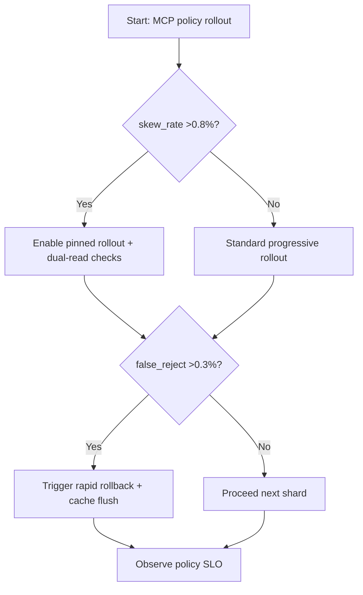
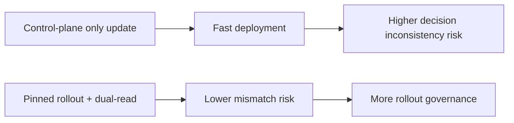
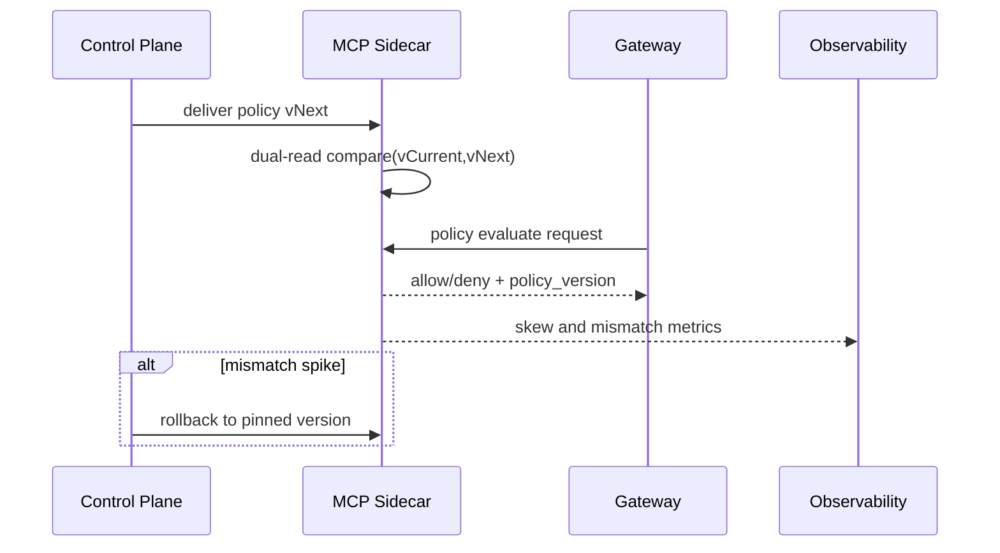

# Agent MCP Sidecar Policy Version-Skew Guard 选型 FAQ（Azure AI Agent Infra）

## 1) 3 分钟结论
- **当 sidecar 策略版本漂移率 >0.8% 或策略拒绝误差 >0.3% 时，必须启用“版本钉扎 + 双读校验 + 灰度回退”。**
- **仅更新控制平面而不做数据平面一致性校验，会导致 MCP 工具调用出现同请求不同判定。**
- **生产阈值：`policy_skew_rate <0.2%`、`rollback_p95 <60s`、`policy_eval_p95 <25ms`。**

## 2) Q1 / Q2 / Q3
- **为什么会出现策略“幽灵拒绝”？**：sidecar 缓存版本滞后或配置分发丢包。
- **为什么要双读校验？**：在版本迁移窗口内验证新旧策略结果差异，避免误杀。
- **最小闭环？**：版本标识透传、分层分发、冲突告警、快速回滚。

### Q1：何时必须冻结升级窗口？
当跨节点策略差异持续 2 个窗口（每 5 分钟）且影响关键租户。

### Q2：何时可快速全量升级？
单集群低风险环境，且历史无策略漂移问题。

### Q3：如何量化收益？
对比误拒下降率与额外校验开销。

## 3) Mermaid 图
### 3.1 决策树

### 3.2 路径对比

### 3.3 时序

## 4) 决策矩阵
| 维度 | 仅控制面更新 | 版本钉扎+双读校验（推荐） |
|---|---:|---:|
| 策略漂移率 | 0.5%–1.6% | 0.05%–0.25% |
| 误拒率 | 0.2%–0.9% | 0.03%–0.15% |
| 发布速度 | 高 | 中 |
| 运维复杂度（1-10） | 4 | 8 |
| 风险可控性 | 中低 | 高 |

## 5) 定量算例与 7-Card 洞察
- 漂移风险：`SkewRisk = SkewedDecisions / TotalDecisions`
- 回滚效率：`RollbackGain = BaselineMTTR - NewMTTR`
- 示例（`synthetic_assumed`）：
  - `SkewedDecisions=120, TotalDecisions=180,000`
  - `SkewRisk=0.067%`
  - `BaselineMTTR=11min, NewMTTR=3.5min`
  - `RollbackGain=7.5min`
- 证据：
  - `workshops/azure-agent-infra/evidence/cycle-1464-benchmark.json`
  - `workshops/azure-agent-infra/evidence/cycle-1464-sources.json`
- 标签：`official/synthetic_assumed/not_measured`。

## 6) 生产核验 Checklist
- [ ] sidecar 策略版本号全链路可见
- [ ] 双读差异阈值与告警已生效
- [ ] 回滚与缓存刷新路径演练通过
- [ ] 关键租户灰度窗口可单独控制
- [ ] FAQ/7-Card 来源标签完整
