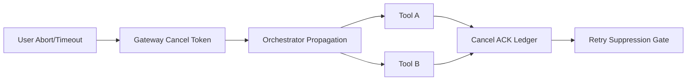

# Agent MCP Tool Cancellation Propagation Selection FAQ (Gateway Timeout Truncation vs End-to-End Cancel Token Propagation)

## 1) Core conclusions
- **End-to-end cancellation token propagation (Gateway -> Orchestrator -> Tool) should be the production default**.
- **Gateway-only timeout truncation leaves orphan tool executions**, causing side-effect drift and cost leakage.
- **Cancellation policy must bind to ACK semantics and retry suppression**, or retries can replay canceled side effects.

## 2) Q1 / Q2 / Q3 (plain terms first)
- **Gateway timeout truncation**: client receives timeout, but downstream execution may still continue.
- **Cancellation token propagation**: one cancel token is propagated across every hop so downstream workers can stop.

### Q1: Why is “client timeout returned” still insufficient?
First principle: response termination is not execution termination. Without cancellation propagation, state diverges into “response done, execution still running.”

### Q2: When can gateway-only truncation be acceptable?
Only for fully read-only, ultra-short tool chains with no material side effects.

### Q3: What is the minimum safe control loop?
Create cancel token -> propagate across all hops -> tool stop ACK -> audit ledger write -> retry suppression. Missing any step creates consistency risk.

## 3) Mermaid (propagation loop)

## 4) Decision matrix
| Dimension | Gateway-only timeout truncation | End-to-end cancel-token propagation |
|---|---|---|
| Implementation complexity | Low | Medium-High |
| Orphan execution control | Low | High |
| Side-effect consistency | Low | High |
| Auditability | Medium | High |
| Default production fit | Low-risk read-only short flows | Multi-hop side-effecting chains |

## 5) Evidence contract + recomputable examples (n/denominator/source)
> Percentages in this section are `synthetic_assumed` hypothetical examples for mechanism comparison; production cancellation validation remains `not_measured`.  
> Contract fields: `workshops/azure-agent-infra/evidence/cycle-422-benchmark.json` -> `percentage_contract`.

- Metric A (orphan execution rate, gateway-only truncation)  
  - Formula: `n_orphan_gateway_only / n_cancelled_requests`  
  - Value: `146/1800 = 8.1%` (`synthetic_assumed`)  
  - Path: `percentage_contract.gateway_only_orphan_rate`
- Metric B (orphan execution rate, end-to-end propagation)  
  - Formula: `n_orphan_end_to_end / n_cancelled_requests`  
  - Value: `29/1800 = 1.6%` (`synthetic_assumed`)  
  - Path: `percentage_contract.end_to_end_orphan_rate`
- Metric C (cancellation consistency gain, percentage points)  
  - Formula: `(n_consistent_e2e - n_consistent_gateway) / n_cancelled_requests`  
  - Value: `(1712-1508)/1800 = 11.3 percentage points` (`synthetic_assumed`)  
  - Path: `percentage_contract.cancel_consistency_gain_pts`

## 6) Production checklist
- [ ] Cancel-token contract and versioning exist across gateway/orchestrator/tool layers
- [ ] Tool stop ACK is traceable and persisted in an immutable audit ledger
- [ ] Retry suppression is enforced after cancellation to prevent side-effect replay
- [ ] Metrics are tagged with `synthetic_assumed`, denominator, and units; production validation remains `not_measured`
