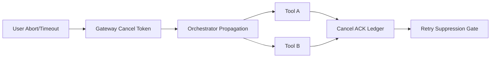

# Agent MCP 工具取消传播选型 FAQ（仅网关超时截断 vs 端到端取消令牌传播）

## 1) 核心结论（先给负责人）
- **生产默认采用端到端取消令牌传播**（Gateway→Orchestrator→Tool），不能只靠网关超时截断。
- **仅网关截断会留下孤儿执行**，造成工具侧继续写入与成本泄漏。
- **取消策略必须绑定停止回执与重试抑制语义**，否则重试会重放已取消副作用。

## 2) Q1 / Q2 / Q3（术语先通俗解释）
- **网关超时截断**：网关对客户端返回超时，但下游任务可能仍在运行。
- **取消令牌传播**：把同一 cancel token 传递到每一跳，确保下游可感知并停止。

### Q1：为什么“前端已经超时返回”还不够？
第一性原理：用户侧响应结束不等于下游执行结束。若无取消传播，系统状态会发生“响应已结束、执行仍继续”的分叉。

### Q2：什么时候可接受仅网关截断？
仅在完全只读、无副作用、且工具执行时间极短的内部链路可接受。

### Q3：取消传播最小闭环是什么？
创建 cancel token -> 全链路透传 -> 工具确认停止 -> 回执写入审计 -> 重试抑制；缺任一步都会留下一致性风险。

## 3) Mermaid（取消传播路径）

## 4) 决策矩阵
| 维度 | 仅网关超时截断 | 端到端取消令牌传播 |
|---|---|---|
| 实现复杂度 | 低 | 中-高 |
| 孤儿执行控制 | 低 | 高 |
| 副作用一致性 | 低 | 高 |
| 可审计性 | 中 | 高 |
| 生产默认建议 | 低风险只读短任务 | 多跳有副作用链路 |

## 5) 数据证据与可复算算例（含 n/分母/来源）
> 本节百分比为 `synthetic_assumed` 假设算例（hypothetical），用于机制对比；生产取消机制认证仍为 `not_measured`。  
> 合同字段见：`workshops/azure-agent-infra/evidence/cycle-422-benchmark.json` 的 `percentage_contract`。

- 指标 A（孤儿执行率，网关截断）  
  - 定义：`n_orphan_gateway_only / n_cancelled_requests`  
  - 值：`146/1800 = 8.1%`（`synthetic_assumed`）  
  - 路径：`percentage_contract.gateway_only_orphan_rate`
- 指标 B（孤儿执行率，端到端传播）  
  - 定义：`n_orphan_end_to_end / n_cancelled_requests`  
  - 值：`29/1800 = 1.6%`（`synthetic_assumed`）  
  - 路径：`percentage_contract.end_to_end_orphan_rate`
- 指标 C（取消一致性提升，百分点）  
  - 定义：`(n_consistent_e2e - n_consistent_gateway) / n_cancelled_requests`  
  - 值：`(1712-1508)/1800 = 11.3` 个百分点（`synthetic_assumed`）  
  - 路径：`percentage_contract.cancel_consistency_gain_pts`

## 6) 生产 Checklist（上线前必须打勾）
- [ ] cancel token 在网关/编排/工具三层都有字段契约与版本
- [ ] 工具端停止回执（ACK）可追踪并写入审计账本
- [ ] 已实现取消后重试抑制，避免副作用重放
- [ ] 指标已标注 `synthetic_assumed` 与分母/单位，生产机制认证保持 `not_measured`
