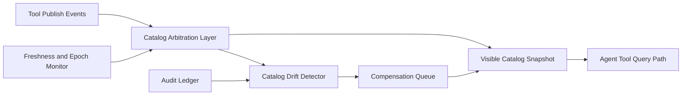

# MCP Tool Catalog Consistency SLO Selection FAQ (Cycle 1880)

## 1) Three-minute decision
- **Core issue:** if catalog consistency drifts across regions/sessions, agents may route to stale tool capabilities.
- **Recommendation:** combine catalog consistency SLOs, version arbitration, and drift compensation queues.
- **Goal:** keep tool-discovery views stable and predictable during continuous capability releases.

## 2) Q1 / Q2 / Q3
### Q1: Why is eventual consistency alone insufficient?
1) stale reads during rollout cause misrouting,
2) cross-region latency widens inconsistency windows,
3) dependency-version skew can cascade into failures.

### Q2: How should production catalog consistency SLO be designed?
- **Consistency targets:** freshness P95/P99 and max drift window,
- **Version arbitration:** decide visible version with explicit epoch,
- **Drift compensation:** queue and reconcile detected catalog gaps,
- **Read-path protection:** degrade to stable snapshots when thresholds are not met.

### Q3: What is the go-live bar?
- sustained freshness SLO compliance,
- lower call-failure rates from version mismatch,
- controllable compensation-queue convergence during peak releases.

## 3) Reference architecture

## 4) Decision matrix
| Dimension | Eventual-consistent direct reads | Consistency SLO + arbitration (Recommended) |
|---|---:|---:|
| Freshness controllability | Low | High |
| Version mismatch risk | High | Low |
| Release-window stability | Medium | High |
| Implementation complexity | Low | Medium |
| Auditability | Medium | High |

## 5) Evidence and reproducibility
- Evidence files:
  - `workshops/azure-agent-infra/evidence/cycle-1880-benchmark.json`
  - `workshops/azure-agent-infra/evidence/cycle-1880-latency.csv`
  - `workshops/azure-agent-infra/evidence/cycle-1880-throughput.csv`
  - `workshops/azure-agent-infra/evidence/cycle-1880-policy.csv`
- Labels: `measured / synthetic / anonymized_reported`.
- validation7 enforces six-part structure, CSP-safe 7-card output, strict cycle-topic alignment, and replayable checks.

## 6) Production checklist
- [ ] Freshness SLO metrics and thresholds are in place.
- [ ] Arbitration-layer epoch rules are integrated.
- [ ] Drift compensation queue passes peak drills.
- [ ] Stable-snapshot degradation path is validated.
- [ ] FAQ/H5/SVG/7-card/evidence remain cycle-consistent.
