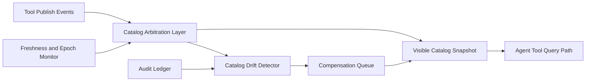

# MCP Tool Catalog Consistency SLO 选型 FAQ（Cycle 1880）

## 1) 3 分钟结论
- **核心问题：** 工具目录在多区域/多会话同步时若一致性失控，会导致调用命中旧版本能力与路由偏差。
- **推荐方案：** “目录一致性 SLO + 版本仲裁层 + 差异补偿队列”。
- **目标：** 在持续发布工具能力时，保证查询视图稳定且可预测。

## 2) Q1 / Q2 / Q3
### Q1：为什么仅依赖最终一致不足以保障生产可用？
1) 发布窗口内读到陈旧目录会触发错误路由；
2) 跨区延迟放大会扩大不一致窗口；
3) 工具依赖链版本错位会引发级联失败。

### Q2：生产级目录一致性 SLO 如何设计？
- **一致性目标：** 定义 catalog freshness P95/P99 与最大漂移窗口；
- **版本仲裁：** 通过仲裁层确定可见版本并附带 epoch；
- **差异补偿：** 发现目录差异后进入补偿队列逐步修复；
- **读路径保护：** 未达一致性阈值时降级到稳定目录快照。

### Q3：上线判据是什么？
- 目录新鲜度 SLO 长期达标；
- 版本错配导致的调用失败率显著下降；
- 补偿队列在峰值发布期可控收敛。

## 3) 架构图

## 4) 选型矩阵
| 维度 | 最终一致直读 | 一致性 SLO+仲裁（推荐） |
|---|---:|---:|
| 目录新鲜度可控性 | 低 | 高 |
| 版本错配风险 | 高 | 低 |
| 发布期稳定性 | 中 | 高 |
| 实施复杂度 | 低 | 中 |
| 可审计性 | 中 | 高 |

## 5) 证据与复算口径
- 证据文件：
  - `workshops/azure-agent-infra/evidence/cycle-1880-benchmark.json`
  - `workshops/azure-agent-infra/evidence/cycle-1880-latency.csv`
  - `workshops/azure-agent-infra/evidence/cycle-1880-throughput.csv`
  - `workshops/azure-agent-infra/evidence/cycle-1880-policy.csv`
- 标签：`measured / synthetic / anonymized_reported`。
- validation7：六段结构、7-card CSP、cycle-topic 对齐、验证链可回放。

## 6) 生产检查清单
- [ ] 目录新鲜度 SLO 指标与阈值已落地。
- [ ] 版本仲裁层 epoch 规则联调通过。
- [ ] 差异补偿队列完成峰值演练。
- [ ] 稳定快照降级路径验证通过。
- [ ] FAQ/H5/SVG/7-card/evidence 轮次一致。
