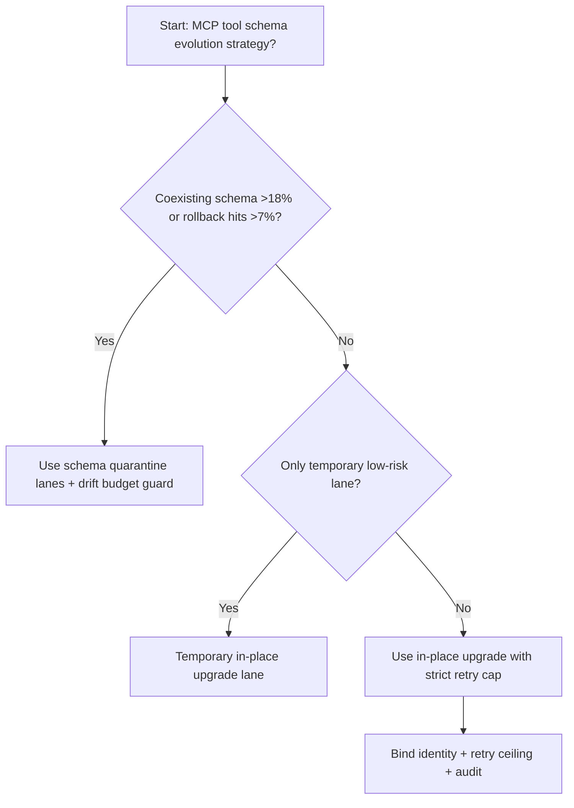
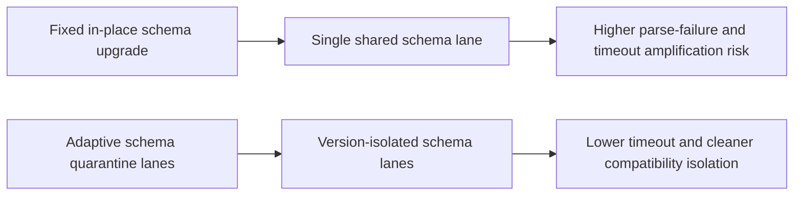
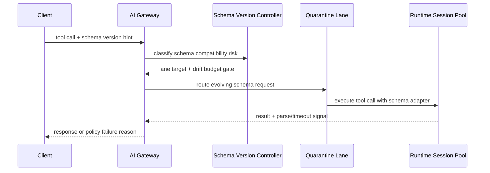

# Agent MCP Tool Schema Evolution Quarantine Selection FAQ (Fixed In-place Schema Upgrade vs Adaptive Schema Quarantine Lanes + Drift Budget Guard)

## 1) Core conclusions (for decision-makers first)
- **When schema coexistence exceeds 18% and compatibility rollback hits exceed 7%, default to schema-quarantine lanes**; below this boundary, in-place upgrades can remain temporary.
- **When tool-call parse failure exceeds 1.1% and schema propagation latency P95 exceeds 95ms, fixed in-place schema upgrade enters the 9.9% timeout band**, so quarantine-lane routing becomes mandatory.
- **When cross-tenant schema-drift conflict exceeds 0.8% and replay-repair rate exceeds 2.5%, enforce drift-budget + replay audit**, or compatibility incidents become non-traceable.

## 2) Q1 / Q2 / Q3 (plain-language definitions first)
- **Fixed In-place Schema Upgrade**: new schema versions replace old ones in the same lane; short path, but risky under version skew.
- **Adaptive Schema Quarantine Lanes + Drift Budget Guard**: evolving-schema requests are first isolated in quarantine lanes, then gradually promoted under drift-budget controls.

### Q1: Why does in-place upgrade jitter under frequent schema changes?
First principles: callers and tools upgrade on different clocks. Direct replacement exposes mismatch to the main lane, amplifying parse failures and retries.

### Q2: When is in-place upgrade still acceptable?
Only when coexistence stays <6%, parse failure stays <0.2%, and propagation latency P95 stays <40ms in temporary low-risk lanes.

### Q3: What is the minimum safe control loop?
Version detection -> schema lane routing -> compatibility gate validation -> failure/replay audit -> threshold recalibration.

## 3) Mermaid (decision tree / path comparison / sequence)
### 3.1 Selection decision tree

### 3.2 Path comparison

### 3.3 Runtime sequence

## 4) Decision matrix
| Dimension | Fixed In-place Schema Upgrade | Adaptive Schema Quarantine Lanes + Drift Budget Guard |
|---|---|---|
| Implementation complexity | Low | Medium |
| Version-conflict resilience | Medium-Low | High |
| Timeout risk control | Medium-Low | High |
| Multi-tenant stability | Medium | High |
| Default production fit | Temporary low-priority lane only | Long-term default |

## 5) Evidence contract + recomputable examples (n/denominator/source)
> Percentages in this section are `synthetic_assumed` hypothetical examples for mechanism comparison; production mechanism validation remains `not_measured`.  
> Contract fields: `workshops/azure-agent-infra/evidence/cycle-526-benchmark.json` -> `percentage_contract`.

- Metric A (in-place-upgrade timeout rate)  
  - Formula: `n_fixed_inplace_schema_upgrade_timeout / n_gateway_requests_observed`  
  - Value: `438/4410 = 9.9%` (`synthetic_assumed`)  
  - Path: `percentage_contract.fixed_inplace_schema_upgrade_timeout_rate`
- Metric B (quarantine-lane timeout rate)  
  - Formula: `n_adaptive_schema_quarantine_timeout / n_gateway_requests_observed`  
  - Value: `167/4410 = 3.8%` (`synthetic_assumed`)  
  - Path: `percentage_contract.adaptive_schema_quarantine_timeout_rate`
- Metric C (recovery gain, percentage points)  
  - Formula: `(n_recovered_adaptive_schema_quarantine - n_recovered_fixed_inplace_schema_upgrade) / n_gateway_requests_observed`  
  - Value: `(4140-3834)/4410 = 6.9 percentage points` (`synthetic_assumed`)  
  - Path: `percentage_contract.adaptive_schema_quarantine_recovery_gain_pts`

## 6) Production checklist
- [ ] Schema-quarantine policy, adapter rollback, and staged rollout paths are drillable
- [ ] Coexistence rate, parse-failure rate, retry ceilings, and drift budgets are observable and auditable
- [ ] Compatibility conflicts, replay repairs, and audit chains are tenant-traceable
- [ ] All metrics are tagged `synthetic_assumed` with denominator/unit; production validation remains `not_measured`
