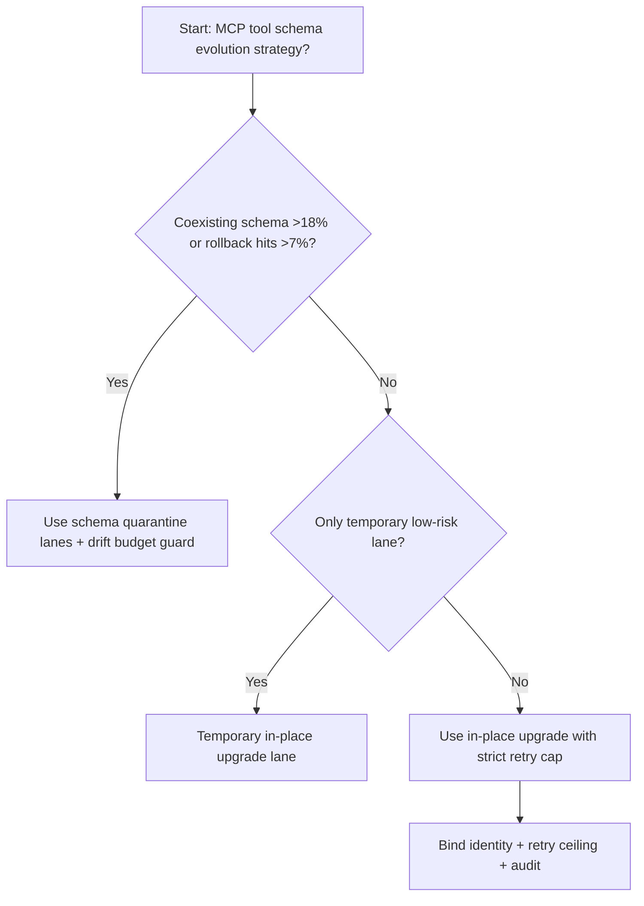
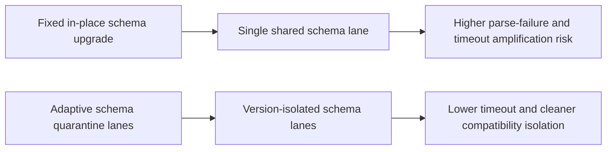
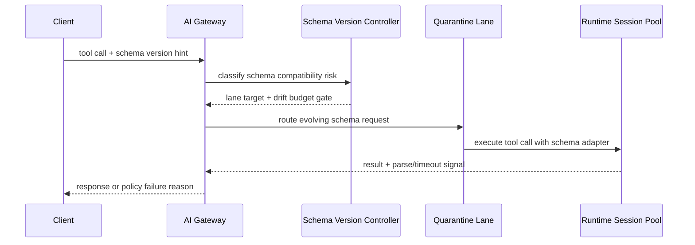

# Agent MCP Tool Schema Evolution Quarantine 选型 FAQ（Fixed In-place Schema Upgrade vs Adaptive Schema Quarantine Lanes + Drift Budget Guard）

## 1) 核心结论（先给负责人）
- **当 schema 版本并存率 >18% 且兼容回退命中 >7% 时，生产默认应选 Schema Quarantine Lanes 治理**；低于阈值可短期保留原地升级。
- **当工具调用解析失败率 >1.1% 且 schema 变更传播延迟 P95 >95ms 时，Fixed In-place Schema Upgrade 会进入 9.9% 超时档**，必须切换隔离通道路径。
- **当跨租户 schema 漂移冲突 >0.8% 且回放修复率 >2.5% 时，必须启用 drift budget + replay audit**，否则兼容性事件不可追溯。

## 2) Q1 / Q2 / Q3（术语先通俗解释）
- **Fixed In-place Schema Upgrade**：新旧 schema 在同一通道直接替换，流程短但冲突期容易影响全量请求。
- **Adaptive Schema Quarantine Lanes + Drift Budget Guard**：把新 schema 请求先分流到隔离通道验证，再按漂移预算逐步放量。

### Q1：为什么原地升级在频繁变更期容易抖动？
第一性原理：调用方与工具端升级节奏不一致。直接替换会把版本错配暴露给主通道，触发解析失败与重试放大。

### Q2：什么时候还可短期使用原地升级？
仅在并存率 <6%、解析失败率 <0.2%、传播延迟 P95 <40ms 的短时低风险场景。

### Q3：最小安全闭环是什么？
版本探测 -> schema 通道路由 -> 兼容门禁校验 -> 失败/回放审计 -> 阈值回归校准。

## 3) Mermaid（决策树 / 路径对比 / 时序）
### 3.1 选型决策树

### 3.2 路径对比图

### 3.3 运行时序图

## 4) 选型决策矩阵
| 维度 | Fixed In-place Schema Upgrade | Adaptive Schema Quarantine Lanes + Drift Budget Guard |
|---|---|---|
| 实现复杂度 | 低 | 中 |
| 版本冲突抗压能力 | 中-低 | 高 |
| 超时风险控制 | 中-低 | 高 |
| 多租户稳定性 | 中 | 高 |
| 生产默认建议 | 仅临时低优先级通道 | 长期默认 |

## 5) 数据证据与可复算算例（含 n/分母/来源）
> 本节百分比为 `synthetic_assumed` 假设算例（hypothetical），用于机制比较；生产机制认证保持 `not_measured`。  
> 合同字段见：`workshops/azure-agent-infra/evidence/cycle-526-benchmark.json` 的 `percentage_contract`。

- 指标 A（原地升级超时率）  
  - 定义：`n_fixed_inplace_schema_upgrade_timeout / n_gateway_requests_observed`  
  - 值：`438/4410 = 9.9%`（`synthetic_assumed`）  
  - 路径：`percentage_contract.fixed_inplace_schema_upgrade_timeout_rate`
- 指标 B（隔离通道超时率）  
  - 定义：`n_adaptive_schema_quarantine_timeout / n_gateway_requests_observed`  
  - 值：`167/4410 = 3.8%`（`synthetic_assumed`）  
  - 路径：`percentage_contract.adaptive_schema_quarantine_timeout_rate`
- 指标 C（恢复增益，百分点）  
  - 定义：`(n_recovered_adaptive_schema_quarantine - n_recovered_fixed_inplace_schema_upgrade) / n_gateway_requests_observed`  
  - 值：`(4140-3834)/4410 = 6.9` 个百分点（`synthetic_assumed`）  
  - 路径：`percentage_contract.adaptive_schema_quarantine_recovery_gain_pts`

## 6) 生产 Checklist（上线前必须打勾）
- [ ] Schema 隔离通道策略、适配器回滚和灰度路径可演练
- [ ] 版本并存率、解析失败率、重试上限与漂移预算均可观测可审计
- [ ] 兼容冲突、回放修复与审计链路可按租户追踪
- [ ] 指标全部标注 `synthetic_assumed`、分母与单位；生产机制认证保持 `not_measured`
