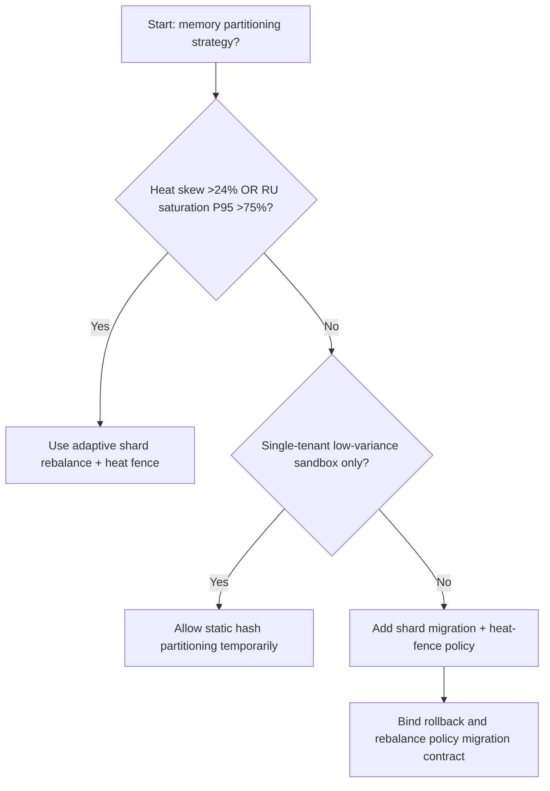
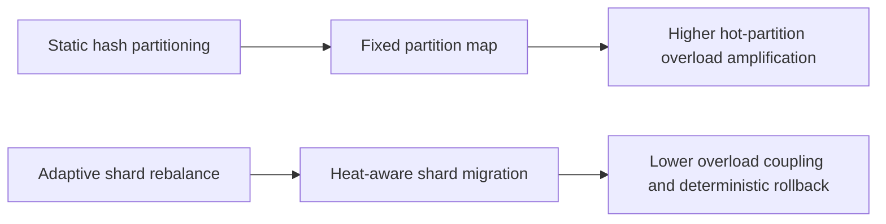
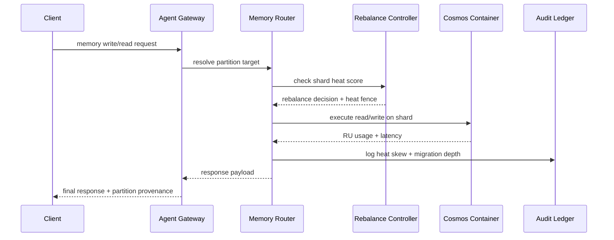

# Agent Memory Cosmos Hot-Partition Rebalance Selection FAQ (Static Hash Partitioning vs Adaptive Shard Rebalance + Heat Fence)

## 1) Core conclusions (for decision-makers first)
- **When tenant write-heat skew is >24% and partition RU saturation P95 is >75%, production should default to Adaptive Shard Rebalance + Heat Fence**; static hash partitioning amplifies hot partitions.
- **When hot-partition replay share is >11% and cross-partition fallback P95 is >280ms, Static Hash Partitioning enters the 12.1% overload band**, requiring adaptive rebalance.
- **When memory writes and retrieval share the same container under concurrency, heat fences and shard-migration policy are mandatory**, or tail-query latency cascades.

## 2) Q1 / Q2 / Q3 (plain-language definitions first)
- **Static Hash Partitioning**: fixed hash-to-partition mapping; simple but poor at absorbing dynamic hotspots.
- **Adaptive Shard Rebalance + Heat Fence**: rebalances shards by observed heat and fences migration jitter.

### Q1: Why do hot partitions affect agent experience?
First principles: the hottest partition determines effective system headroom. Once one partition saturates, read/write latency drags the entire path.

### Q2: When is static hash partitioning still acceptable temporarily?
Only for small-tenant, stable-write early PoCs. Move to adaptive rebalance for multi-tenant production.

### Q3: What is the minimum safe loop?
Heat sampling -> shard rebalance -> heat-fence validation -> read/write replay -> threshold tuning.

## 3) Mermaid (decision tree / path comparison / sequence)
### 3.1 Selection decision tree

### 3.2 Path comparison

### 3.3 Runtime sequence

## 4) Decision matrix
| Dimension | Static Hash Partitioning | Adaptive Shard Rebalance + Heat Fence |
|---|---|---|
| Implementation complexity | Low | Medium |
| Hotspot absorption | Low-Medium | High |
| Tail-latency risk | High | Low |
| Multi-tenant controllability | Medium-Low | High |
| Default production fit | Experimental short-term only | Long-term default |

## 5) Evidence contract + recomputable examples (n/denominator/source)
> Percentages in this section are `synthetic_assumed` hypothetical examples for mechanism comparison; production mechanism validation remains `not_measured`.  
> Contract fields: `workshops/azure-agent-infra/evidence/cycle-539-benchmark.json` -> `percentage_contract`.

- Metric A (static-partition overload rate)  
  - Formula: `n_static_partition_overload / n_gateway_requests_observed`  
  - Value: `534/4410 = 12.1%` (`synthetic_assumed`)  
  - Path: `percentage_contract.static_partition_overload_rate`
- Metric B (adaptive-rebalance overload rate)  
  - Formula: `n_adaptive_rebalance_overload / n_gateway_requests_observed`  
  - Value: `216/4410 = 4.9%` (`synthetic_assumed`)  
  - Path: `percentage_contract.adaptive_rebalance_overload_rate`
- Metric C (recovery gain, percentage points)  
  - Formula: `(n_recovered_rebalance - n_recovered_static_partition) / n_gateway_requests_observed`  
  - Value: `(4058-3728)/4410 = 7.5 percentage points` (`synthetic_assumed`)  
  - Path: `percentage_contract.rebalance_recovery_gain_pts`

## 6) Production checklist
- [ ] Every tenant has explicit heat thresholds, migration caps, and rollback policy
- [ ] Heat skew, RU saturation, and migration depth are observable and auditable
- [ ] Change flow supports canary rollout, rollback, and tiered promotion
- [ ] All metrics are tagged `synthetic_assumed`; production validation remains `not_measured`
