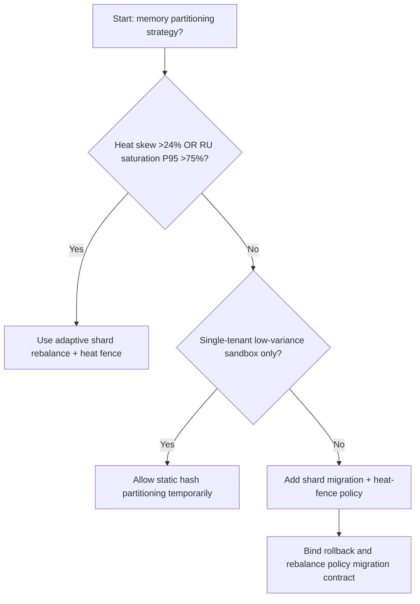
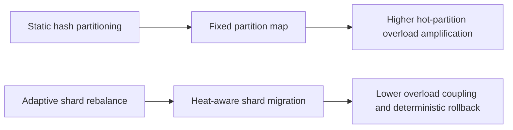
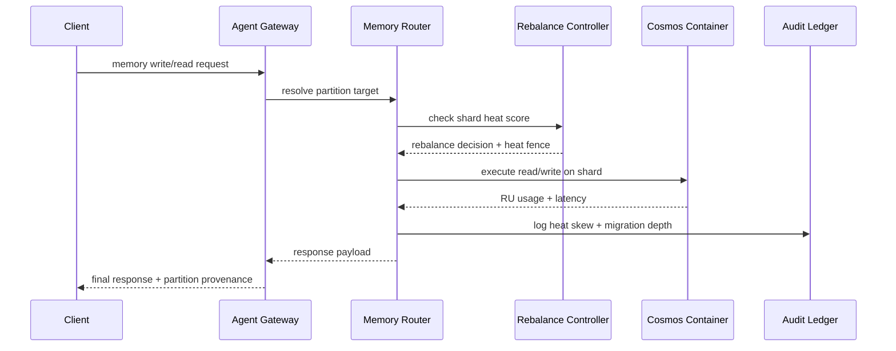

# Agent Memory Cosmos Hot-Partition Rebalance 选型 FAQ（Static Hash Partitioning vs Adaptive Shard Rebalance + Heat Fence）

## 1) 核心结论（先给负责人）
- **当租户写入热点偏斜 >24% 且分区 RU 饱和 P95 >75% 时，生产默认应选 Adaptive Shard Rebalance + Heat Fence**；静态哈希分区会放大热分区。
- **当热点回放比例 >11% 且跨分区回退 P95 >280ms 时，Static Hash Partitioning 会进入 12.1% 过载档**，需切换自适应再均衡。
- **当 Agent 记忆写入与检索并发共享同一容器时，必须启用热度围栏和分片迁移策略**，否则长尾查询延迟会级联。

## 2) Q1 / Q2 / Q3（术语先通俗解释）
- **Static Hash Partitioning**：按固定哈希规则分区，简单但无法动态吸收热点。
- **Adaptive Shard Rebalance + Heat Fence**：根据实时热度重分片，并用热度围栏限制迁移抖动。

### Q1：为什么热分区会影响 Agent 体验？
第一性原理：最热分区决定系统上限。某个分区被打满时，整个读写链路都会被拖慢。

### Q2：什么时候还能短时用静态哈希分区？
仅在租户规模小、写入模式稳定的早期 PoC；进入多租户生产后应启用自适应再均衡。

### Q3：最小闭环是什么？
热度采样 -> 分片再均衡 -> 热度围栏校验 -> 读写回放 -> 阈值调参。

## 3) Mermaid（决策树 / 路径对比 / 时序）
### 3.1 选型决策树

### 3.2 路径对比图

### 3.3 运行时序图

## 4) 选型决策矩阵
| 维度 | Static Hash Partitioning | Adaptive Shard Rebalance + Heat Fence |
|---|---|---|
| 实现复杂度 | 低 | 中 |
| 热点吸收能力 | 低-中 | 高 |
| 长尾延迟风险 | 高 | 低 |
| 多租户可控性 | 中-低 | 高 |
| 生产默认建议 | 仅实验短期 | 长期默认 |

## 5) 数据证据与可复算算例（含 n/分母/来源）
> 本节百分比为 `synthetic_assumed` 假设算例（hypothetical），用于机制比较；生产机制认证保持 `not_measured`。  
> 合同字段见：`workshops/azure-agent-infra/evidence/cycle-539-benchmark.json` 的 `percentage_contract`。

- 指标 A（静态分区过载率）  
  - 定义：`n_static_partition_overload / n_gateway_requests_observed`  
  - 值：`534/4410 = 12.1%`（`synthetic_assumed`）  
  - 路径：`percentage_contract.static_partition_overload_rate`
- 指标 B（自适应再均衡过载率）  
  - 定义：`n_adaptive_rebalance_overload / n_gateway_requests_observed`  
  - 值：`216/4410 = 4.9%`（`synthetic_assumed`）  
  - 路径：`percentage_contract.adaptive_rebalance_overload_rate`
- 指标 C（恢复增益，百分点）  
  - 定义：`(n_recovered_rebalance - n_recovered_static_partition) / n_gateway_requests_observed`  
  - 值：`(4058-3728)/4410 = 7.5` 个百分点（`synthetic_assumed`）  
  - 路径：`percentage_contract.rebalance_recovery_gain_pts`

## 6) 生产 Checklist（上线前必须打勾）
- [ ] 每个租户有明确分片热度阈值、迁移上限与回退策略
- [ ] 热点偏斜、RU 饱和、迁移深度可观测可审计
- [ ] 变更流程具备灰度、回退与分层放量能力
- [ ] 指标全部标注 `synthetic_assumed`，生产机制认证保持 `not_measured`
