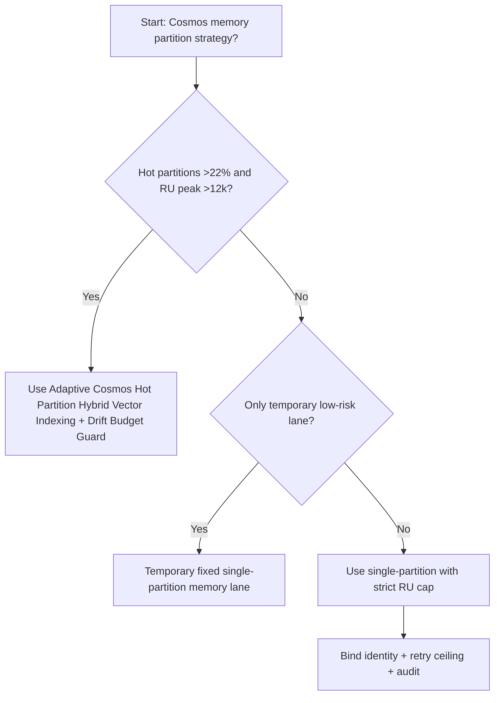
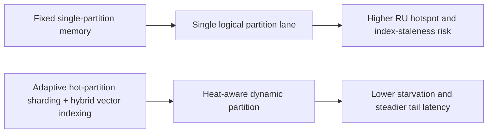
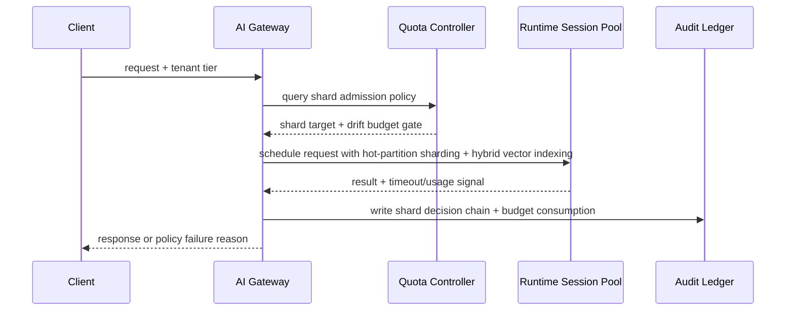

# Agent Runtime Cosmos Hot Partition Hybrid Vector Indexing Selection FAQ (Fixed Single-Partition Memory vs Adaptive Cosmos Hot Partition Hybrid Vector Indexing + Drift Budget Guard)

## 1) Core conclusions (for decision-makers first)
- **When hot-partition share exceeds 22% and per-logical-partition RU peak exceeds 12k RU/s, default to hot-partition sharding + hybrid vector indexing**; below this boundary, single-partition memory can remain acceptable.
- **When vector retrieval P95 recall drops below 0.86 and index-refresh lag exceeds 90s, fixed single-partition memory enters the 12.7% timeout band**, so hybrid indexing becomes mandatory.
- **When rebalance write amplification exceeds 1.35x and cross-region replication latency exceeds 240ms, enforce shard-drift budgets plus replay audit**, or memory consistency becomes non-deterministic.

## 2) Q1 / Q2 / Q3 (plain-language definitions first)
- **Fixed Single-Partition Memory**: a single logical partition serves most writes; predictable, but fragile when hotspot skew rises.
- **Adaptive Cosmos Hot Partition Hybrid Vector Indexing + Drift Budget Guard**: heat-aware partition sharding with HNSW + DiskANN hybrid index routing plus drift-budget gates.

### Q1: Why is single-partition memory fragile at high concurrency?
First principles: memory writes are skewed, so hot partitions saturate RU and index-refresh queues first. A single-partition design pushes tail latency and destabilizes retrieval consistency.

### Q2: When is single-partition memory still acceptable?
Use it only when hot-partition share is <12%, index-refresh lag is <45s, and daily write growth is <15%.

### Q3: What is the minimum safe control loop?
Request classification -> hot-partition detection -> hybrid vector index routing -> timeout/failure audit -> threshold recalibration.

## 3) Mermaid (decision tree / path comparison / sequence)
### 3.1 Selection decision tree

### 3.2 Path comparison

### 3.3 Runtime sequence

## 4) Decision matrix
| Dimension | Fixed Single-Partition Memory | Adaptive Cosmos Hot Partition Hybrid Vector Indexing + Drift Budget Guard |
|---|---|---|
| Implementation complexity | Low | Medium |
| Hotspot resilience | Medium-Low | High |
| Timeout risk control | Medium-Low | High |
| Multi-tenant sustainability | Medium | High |
| Default production fit | Temporary low-priority lane only | Long-term default |

## 5) Evidence contract + recomputable examples (n/denominator/source)
> Percentages in this section are `synthetic_assumed` hypothetical examples for mechanism comparison; production mechanism validation remains `not_measured`.  
> Contract fields: `workshops/azure-agent-infra/evidence/cycle-519-benchmark.json` -> `percentage_contract`.

- Metric A (fixed single-partition memory timeout rate)  
  - Formula: `n_fixed_single_partition_memory_timeout / n_gateway_requests_observed`  
  - Value: `558/4410 = 12.7%` (`synthetic_assumed`)  
  - Path: `percentage_contract.fixed_single_partition_memory_timeout_rate`
- Metric B (adaptive cosmos-hot-partition-vector-indexing timeout rate)  
  - Formula: `n_adaptive_hybrid_vector_partition_timeout / n_gateway_requests_observed`  
  - Value: `221/4410 = 5.0%` (`synthetic_assumed`)  
  - Path: `percentage_contract.adaptive_hybrid_vector_partition_timeout_rate`
- Metric C (recovery gain, percentage points)  
  - Formula: `(n_recovered_adaptive_hybrid_vector - n_recovered_fixed_single_partition) / n_gateway_requests_observed`  
  - Value: `(4054-3712)/4410 = 7.8 percentage points` (`synthetic_assumed`)  
  - Path: `percentage_contract.adaptive_hybrid_vector_partition_recovery_gain_pts`

## 6) Production checklist
- [ ] Hybrid vector-partition admission policy has versioning, staged rollout, and rollback controls
- [ ] Tenant heat, queue depth, retry ceilings, and drift budgets are observable and auditable
- [ ] Starvation events, timeout chains, and replay paths are tenant-traceable
- [ ] All metrics are tagged `synthetic_assumed` with denominator/unit; production validation remains `not_measured`
