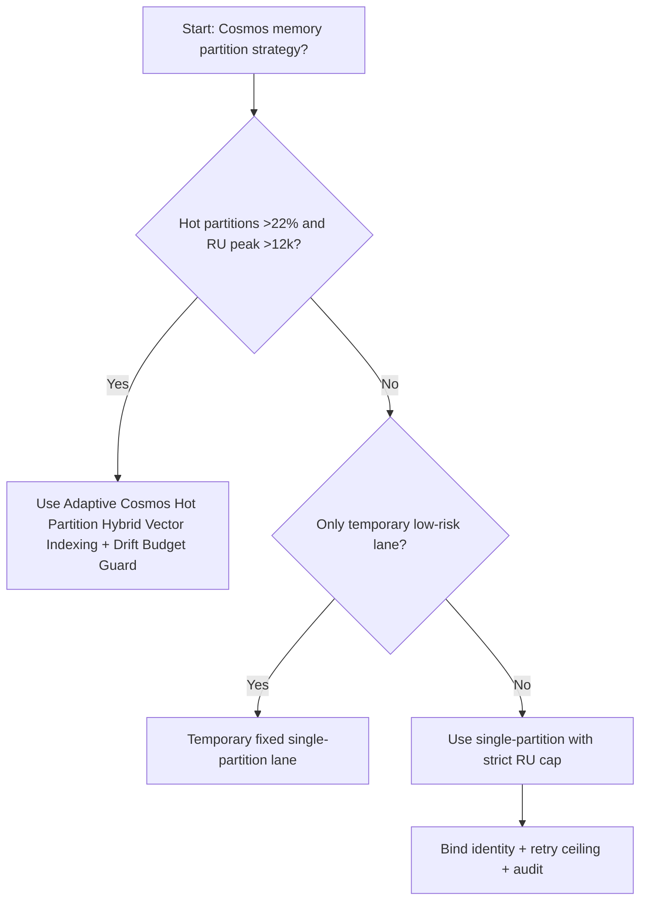
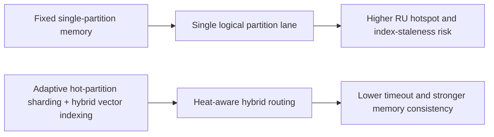
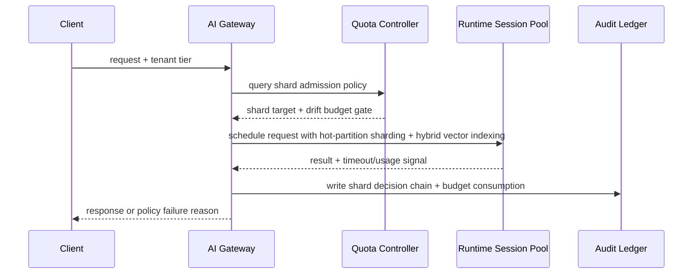

# Agent Runtime Cosmos Hot Partition Hybrid Vector Indexing 选型 FAQ（Fixed Single-Partition Memory vs Adaptive Cosmos Hot Partition Hybrid Vector Indexing + Drift Budget Guard）

## 1) 核心结论（先给负责人）
- **当记忆写入热点分区占比 >22% 且单逻辑分区 RU 峰值 >12k RU/s 时，生产默认应选 Hot-Partition Sharding + Hybrid Vector Indexing**；低于该阈值可维持单分区简化方案。
- **当向量检索 P95 召回 <0.86 且索引刷新滞后 >90s 时，Fixed Single-Partition Memory 会进入 12.7% 超时档**，必须切换混合索引路径。
- **当跨分区重平衡写放大 >1.35× 且跨区复制延迟 >240ms 时，必须启用分片漂移预算与审计回放**，否则记忆一致性会不可预测。

## 2) Q1 / Q2 / Q3（术语先通俗解释）
- **Fixed Single-Partition Memory**：每个租户固定切片，规则稳定但在负载偏斜时利用率低且容易局部饥饿。
- **Adaptive Cosmos Hot Partition Hybrid Vector Indexing + Drift Budget Guard**：按热分区信号动态切分写入分区，并在 HNSW + DiskANN 混合索引路径之间选择，再用漂移预算约束重平衡抖动。

### Q1：为什么固定单分区记忆在高并发更脆弱？
第一性原理：记忆写入并不均匀，热点分区会先打满 RU 和索引刷新队列；若仍单分区承载，尾延迟会快速抬升并拖垮检索一致性。

### Q2：什么时候可短期使用固定单分区记忆？
仅在热点分区占比 <12%、索引刷新滞后 <45s、且日写入增量 <15% 的稳定租户场景短期使用。

### Q3：最小安全闭环是什么？
请求分级 -> 热点分区探测 -> 混合向量索引路由 -> 超时/失败审计 -> 周期阈值回归校准。

## 3) Mermaid（决策树 / 路径对比 / 时序）
### 3.1 选型决策树

### 3.2 路径对比图

### 3.3 运行时序图

## 4) 选型决策矩阵
| 维度 | Fixed Single-Partition Memory | Adaptive Cosmos Hot Partition Hybrid Vector Indexing + Drift Budget Guard |
|---|---|---|
| 实现复杂度 | 低 | 中 |
| 热点抗压能力 | 中-低 | 高 |
| 超时风险控制 | 中-低 | 高 |
| 多租户可持续性 | 中 | 高 |
| 生产默认建议 | 仅临时低优先级通道 | 长期默认 |

## 5) 数据证据与可复算算例（含 n/分母/来源）
> 本节百分比为 `synthetic_assumed` 假设算例（hypothetical），用于机制比较；生产机制认证保持 `not_measured`。  
> 合同字段见：`workshops/azure-agent-infra/evidence/cycle-519-benchmark.json` 的 `percentage_contract`。

- 指标 A（Fixed Single-Partition Memory 超时率）  
  - 定义：`n_fixed_single_partition_memory_timeout / n_gateway_requests_observed`  
  - 值：`558/4410 = 12.7%`（`synthetic_assumed`）  
  - 路径：`percentage_contract.fixed_single_partition_memory_timeout_rate`
- 指标 B（Adaptive Cosmos Hot Partition Hybrid Vector Indexing 超时率）  
  - 定义：`n_adaptive_hybrid_vector_partition_timeout / n_gateway_requests_observed`  
  - 值：`221/4410 = 5.0%`（`synthetic_assumed`）  
  - 路径：`percentage_contract.adaptive_hybrid_vector_partition_timeout_rate`
- 指标 C（恢复增益，百分点）  
  - 定义：`(n_recovered_adaptive_hybrid_vector - n_recovered_fixed_single_partition) / n_gateway_requests_observed`  
  - 值：`(4054-3712)/4410 = 7.8` 个百分点（`synthetic_assumed`）  
  - 路径：`percentage_contract.adaptive_hybrid_vector_partition_recovery_gain_pts`

## 6) 生产 Checklist（上线前必须打勾）
- [ ] 热分区分片与混合向量索引门禁策略具备版本、灰度和回滚路径
- [ ] 租户热度、队列深度、重试上限和漂移预算均可观测可审计
- [ ] 饥饿事件、超时链路与回放审计可按租户追踪
- [ ] 指标全部标注 `synthetic_assumed`、分母与单位；生产机制认证保持 `not_measured`
