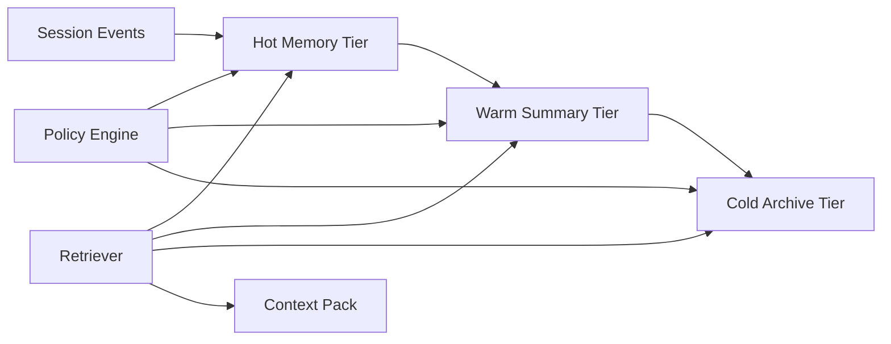

# Agent Memory Tiering Cost Selection FAQ (Cycle 1816)

## 1) Three-minute decision
- **Core issue:** all-hot memory drives runaway cost, while all-cold memory increases latency jitter.
- **Recommendation:** hot tier (recent session memory) + warm tier (phase summaries) + cold tier (audit archive).
- **Goal:** preserve response continuity while reducing per-session cost and long-tail retrieval latency.

## 2) Q1 / Q2 / Q3
### Q1: Why is a single memory tier unsustainable?
1) hot-only: token/cache cost rises linearly with session length,
2) cold-only: broad context reload every turn causes jitter,
3) no tiered eviction: low-value context keeps consuming budget.

### Q2: What tiering strategy works in production?
- **Hot tier:** keep recent N turns and tool outputs for millisecond access,
- **Warm tier:** compress by task phase into structured summaries,
- **Cold tier:** retain audit/replay records for on-demand recovery,
- **Promotion/demotion:** dynamic transitions by access frequency, risk tags, and tenant class.

### Q3: How do we prove “lower cost without quality loss”?
- track per-session cost and cost variance,
- track P95 latency for long conversations,
- monitor context omission and replay-correction rates.

## 3) Reference architecture

## 4) Decision matrix
| Dimension | Single hot tier | Three-tier memory (Recommended) |
|---|---:|---:|
| Per-session cost | High | Medium |
| Long-session latency stability | Medium | High |
| Audit replay capability | Low | High |
| Implementation complexity | Low | Medium |
| Operational tunability | Low | High |

## 5) Evidence and reproducibility
- Evidence files:
  - `workshops/azure-agent-infra/evidence/cycle-1816-benchmark.json`
  - `workshops/azure-agent-infra/evidence/cycle-1816-latency.csv`
  - `workshops/azure-agent-infra/evidence/cycle-1816-throughput.csv`
  - `workshops/azure-agent-infra/evidence/cycle-1816-policy.csv`
- Labels: `measured / synthetic / anonymized_reported`.
- validation7 enforces bilingual six-part structure, CSP self-contained 7-card output, strict cycle-evidence alignment, and replayability.

## 6) Production checklist
- [ ] Hot/warm/cold SLAs and budget caps are defined.
- [ ] Tier transition rules are integrated and observable.
- [ ] Long-session retrieval P95 has been load-tested.
- [ ] Cold-tier audit replay is available and traceable.
- [ ] FAQ/H5/SVG/7-card align with cycle evidence.
