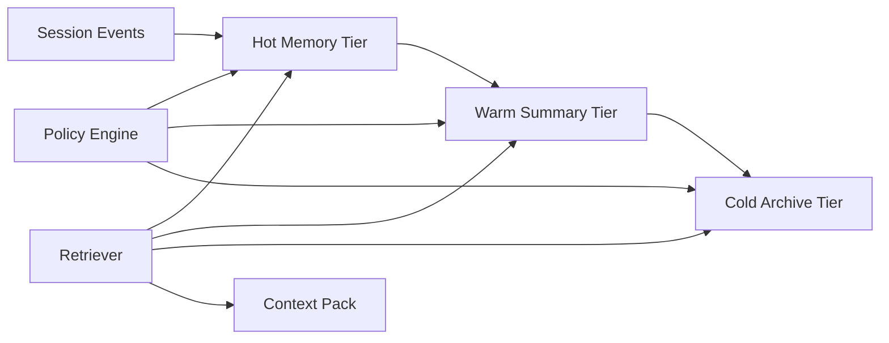

# Agent 记忆分层成本选型 FAQ（Cycle 1816）

## 1) 3 分钟结论
- **问题核心：** 全量热存储会导致成本失控，全量冷存储会拖垮响应时延。
- **推荐：** 热层（会话短记忆）+ 温层（阶段摘要）+ 冷层（审计归档）三层记忆。
- **目标：** 在保证回答连续性的同时，压低单位会话成本并控制检索尾延迟。

## 2) Q1 / Q2 / Q3
### Q1：为什么“只用一种记忆层”不可持续？
1) 纯热层：Token 与缓存成本随会话长度线性上升；
2) 纯冷层：每轮都要大范围回捞上下文，检索延迟抖动大；
3) 无分层淘汰：高频无效上下文长期占用预算。

### Q2：生产可落地的分层策略是什么？
- **热层**：保留最近 N 轮原文与工具结果，毫秒级命中；
- **温层**：按任务阶段压缩为结构化摘要，分钟级更新；
- **冷层**：保留审计与追溯记录，按需回放；
- **迁移规则**：按访问频率、风险标签、租户等级动态升降层。

### Q3：如何验证“降本不降质”？
- 观察单会话成本与成本波动；
- 观察长对话 P95 响应时延；
- 监控上下文遗漏率与回放纠错率。

## 3) 架构图

## 4) 选型矩阵
| 维度 | 单层热存储 | 三层记忆分层（推荐） |
|---|---:|---:|
| 单会话成本 | 高 | 中 |
| 长会话时延稳定性 | 中 | 高 |
| 审计回放能力 | 低 | 高 |
| 实施复杂度 | 低 | 中 |
| 运营可调优性 | 低 | 高 |

## 5) 证据与复算口径
- 证据文件：
  - `workshops/azure-agent-infra/evidence/cycle-1816-benchmark.json`
  - `workshops/azure-agent-infra/evidence/cycle-1816-latency.csv`
  - `workshops/azure-agent-infra/evidence/cycle-1816-throughput.csv`
  - `workshops/azure-agent-infra/evidence/cycle-1816-policy.csv`
- 标签：`measured / synthetic / anonymized_reported`。
- validation7：双语六段结构、7-card CSP 自包含、轮次与 evidence 严格一致、链路可回放。

## 6) 生产检查清单
- [ ] 热/温/冷层 SLA 与预算上限已定义。
- [ ] 记忆升降层规则已联调并可观测。
- [ ] 长会话检索链路 P95 已压测。
- [ ] 冷层审计回放可用并可追踪。
- [ ] FAQ/H5/SVG/7-card 与 evidence 轮次一致。
