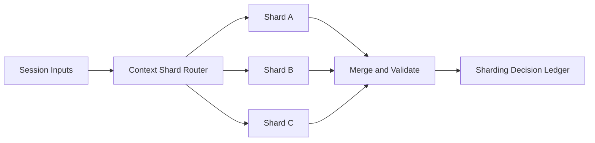

# Agent Model Context Sharding Selection FAQ (Cycle 1813)

## 1) Three-minute decision
- **Long-context throughput bottlenecks are often caused by single-shard serial processing, not model capability limits.**
- **Recommendation:** context sharding + shard affinity routing + merge validation pipeline.
- **Goal:** improve concurrent throughput and control long-context latency while preserving semantic consistency.

## 2) Q1 / Q2 / Q3
### Q1: Why does single-shard context processing destabilize?
1) large sessions monopolize context windows,
2) hotspot tenants amplify queue jitter,
3) single-node faults create large blast radius.

### Q2: What practical sharding strategy works?
- shard by tenant plus session key,
- preserve session-shard affinity to reduce reshuffle,
- validate ordering and version during cross-shard merge,
- use hierarchical summaries and reference refill for ultra-long context.

### Q3: How to validate effectiveness?
- higher concurrent throughput,
- lower P95/P99 latency,
- fewer merge-consistency errors.

## 3) Reference architecture

## 4) Decision matrix
| Dimension | Single-shard processing | Context sharding (Recommended) |
|---|---:|---:|
| Throughput elasticity | Low | High |
| Long-context latency | High | Medium |
| Fault isolation | Low | High |
| Implementation complexity | Low | Medium |
| Consistency governance | Medium | High |

## 5) Evidence and reproducibility
- Evidence files:
  - `workshops/azure-agent-infra/evidence/cycle-1813-benchmark.json`
  - `workshops/azure-agent-infra/evidence/cycle-1813-latency.csv`
  - `workshops/azure-agent-infra/evidence/cycle-1813-throughput.csv`
  - `workshops/azure-agent-infra/evidence/cycle-1813-policy.csv`
- Labels: `measured / synthetic / anonymized_reported`.
- validation7 requires bilingual structure fidelity, CSP self-contained cards, cycle-consistent evidence, and replayability checks.

## 6) Production checklist
- [ ] Shard key and routing rules are fixed.
- [ ] Session affinity and cross-shard migration are observable.
- [ ] Merge checks enforce ordering and version consistency.
- [ ] Ultra-long context summary/refill strategy is validated.
- [ ] FAQ/H5/SVG/7-card align with cycle evidence.
