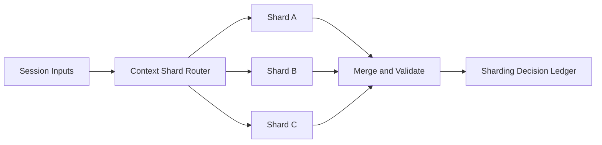

# Agent 模型上下文分片选型 FAQ（Cycle 1813）

## 1) 3 分钟结论
- **长上下文吞吐瓶颈常由“单分片串行处理”引发，而不是模型能力不足。**
- **推荐：** 会话上下文分片 + 路由亲和 + 汇聚校验三段架构。
- **目标：** 提升并发吞吐并控制长上下文延迟，同时保持语义一致性。

## 2) Q1 / Q2 / Q3
### Q1：为什么单分片上下文会失稳？
1) 大会话抢占全部上下文窗口；
2) 热点租户导致排队抖动；
3) 单节点故障影响范围过大。

### Q2：可落地分片策略是什么？
- 依据租户+会话键做上下文分片；
- 保持会话分片亲和，减少跨分片重组；
- 跨分片汇总时执行顺序和版本校验；
- 对超长上下文采用分层摘要与引用回填。

### Q3：如何验证策略有效？
- 并发吞吐提升；
- P95/P99 延迟下降；
- 分片汇总一致性错误率降低。

## 3) 架构图

## 4) 选型矩阵
| 维度 | 单分片处理 | 上下文分片（推荐） |
|---|---:|---:|
| 吞吐弹性 | 低 | 高 |
| 长上下文时延 | 高 | 中 |
| 故障隔离能力 | 低 | 高 |
| 实施复杂度 | 低 | 中 |
| 一致性治理 | 中 | 高 |

## 5) 证据与复算口径
- 证据文件：
  - `workshops/azure-agent-infra/evidence/cycle-1813-benchmark.json`
  - `workshops/azure-agent-infra/evidence/cycle-1813-latency.csv`
  - `workshops/azure-agent-infra/evidence/cycle-1813-throughput.csv`
  - `workshops/azure-agent-infra/evidence/cycle-1813-policy.csv`
- 标签：`measured / synthetic / anonymized_reported`。
- validation7：双语结构、CSP 自包含、证据轮次一致、可回放链路校验通过。

## 6) 生产检查清单
- [ ] 分片键与路由规则已固化。
- [ ] 会话亲和与跨分片迁移策略可观测。
- [ ] 汇总校验含顺序与版本一致性。
- [ ] 超长上下文摘要与回填策略已验证。
- [ ] FAQ/H5/SVG/7-card 与 evidence 轮次一致。
