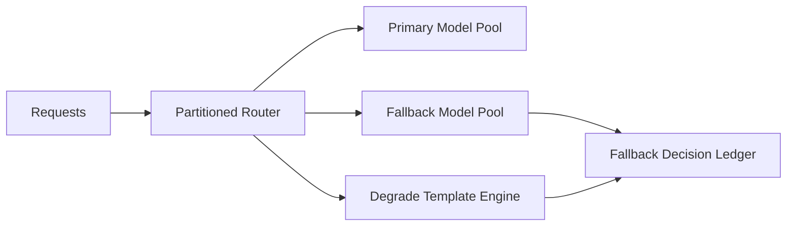

# Agent Model Fallback Blast-Radius Selection FAQ (Cycle 1800)

## 1) Three-minute decision
- **Fallback failures are usually caused not by missing backup models, but by lack of segmented fallback isolation.**
- **Recommendation:** tenant/scenario-partitioned fallback + failure-domain rate caps + tiered degradation templates.
- **Goal:** keep critical continuity during primary-model incidents while minimizing error spread.

## 2) Core questions (Q1/Q2/Q3)
### Q1: Why is global one-switch fallback risky?
1) incident blast spreads to all tenants,
2) secondary models are overwhelmed instantly,
3) cost/latency spikes with weak accountability.

### Q2: What fallback-limiting strategy is practical?
- layer 1: partition routes by tenant and business domain,
- layer 2: set fallback concurrency caps per partition,
- layer 3: auto-degrade low-priority requests via templates,
- support: ledger fallback decisions with rollback controls.

### Q3: How to validate effectiveness?
- high-priority availability is maintained during incidents,
- secondary-pool P95 avoids cascading degradation,
- affected-tenant ratio is materially reduced.

## 3) Reference architecture

## 4) Decision matrix
| Dimension | Global fallback | Partitioned capped fallback (Recommended) |
|---|---:|---:|
| Blast-radius control | Low | High |
| Priority availability | Medium | High |
| Secondary-pool stability | Low | High |
| Implementation complexity | Low | Medium |
| Audit explainability | Medium | High |

## 5) Evidence and reproducibility
- Evidence files:
  - `workshops/azure-agent-infra/evidence/cycle-1800-benchmark.json`
  - `workshops/azure-agent-infra/evidence/cycle-1800-latency.csv`
  - `workshops/azure-agent-infra/evidence/cycle-1800-throughput.csv`
  - `workshops/azure-agent-infra/evidence/cycle-1800-policy.csv`
- Labels: `measured / synthetic / anonymized_reported`.
- validation7 requires bilingual structure fidelity, CSP self-contained cards, cycle-consistent evidence, and replayability checks.

## 6) Production checklist
- [ ] Partitioned fallback routing by tenant/SLA is enforced.
- [ ] Fallback concurrency/rate caps are load-tested.
- [ ] Degrade templates apply only to low-priority paths.
- [ ] Fallback audit and rollback flows are drill-ready.
- [ ] FAQ/H5/SVG/7-card align with cycle evidence.
