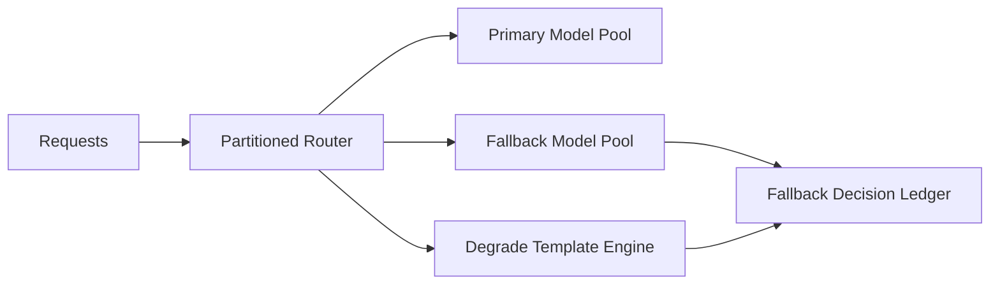

# Agent 模型回退爆炸半径选型 FAQ（Cycle 1800）

## 1) 3 分钟结论
- **模型回退机制失效通常不是“没有备选模型”，而是“回退范围缺少分段隔离”。**
- **推荐：** 按租户/场景分区回退 + 失败域限幅 + 分级降级模板。
- **目标：** 在主模型异常时保证关键业务连续性，同时把错误扩散限制在最小范围。

## 2) 关键问题（Q1/Q2/Q3）
### Q1：为什么全局一键回退风险高？
1) 故障扩散到全部租户；
2) 次级模型被瞬时打爆；
3) 成本与延迟突增且难追责。

### Q2：可落地的回退限幅策略？
- 一级：按租户与业务域分区路由；
- 二级：每个分区设置回退并发上限；
- 三级：低优请求自动降级模板输出；
- 配套：回退决策写入审计账本并可回滚。

### Q3：如何验证策略有效？
- 主模型异常时高优可用率保持；
- 次级模型 P95 未出现级联恶化；
- 受影响租户比例明显下降。

## 3) 架构图

## 4) 选型矩阵
| 维度 | 全局回退 | 分区限幅回退（推荐） |
|---|---:|---:|
| 故障扩散控制 | 低 | 高 |
| 高优可用性保障 | 中 | 高 |
| 次级池稳定性 | 低 | 高 |
| 实施复杂度 | 低 | 中 |
| 审计可解释性 | 中 | 高 |

## 5) 证据与复算口径
- 证据文件：
  - `workshops/azure-agent-infra/evidence/cycle-1800-benchmark.json`
  - `workshops/azure-agent-infra/evidence/cycle-1800-latency.csv`
  - `workshops/azure-agent-infra/evidence/cycle-1800-throughput.csv`
  - `workshops/azure-agent-infra/evidence/cycle-1800-policy.csv`
- 标签：`measured / synthetic / anonymized_reported`。
- validation7：双语结构、CSP 自包含、证据轮次一致、回放链路检查通过。

## 6) 生产检查清单
- [ ] 分区回退路由规则按租户/SLA 生效。
- [ ] 回退并发与速率限幅阈值已压测。
- [ ] 降级模板仅作用低优路径。
- [ ] 回退审计与回滚流程可演练。
- [ ] FAQ/H5/SVG/7-card 与 evidence 轮次一致。
